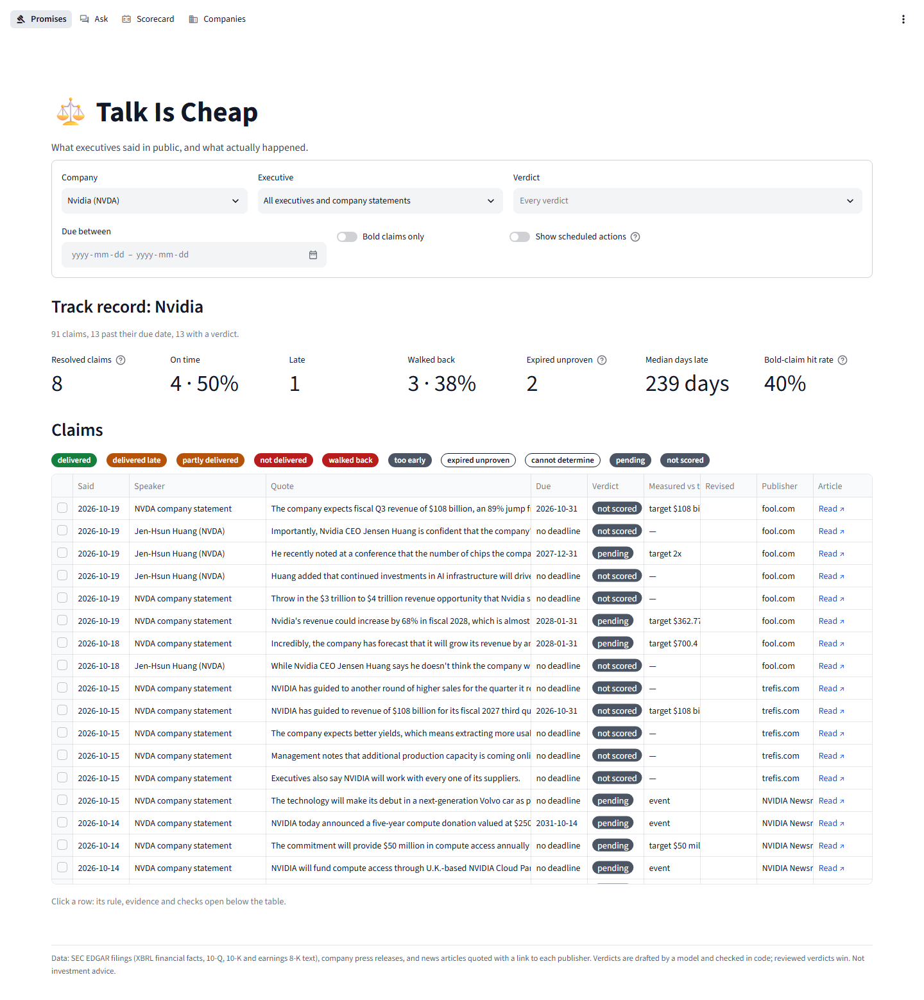

# Talk Is Cheap

*Management talks. Filings keep score.*

An AI analyst for public companies that compares what management says with what the company reports, using SEC EDGAR filings and public news.

## Current state

**The promise tracker**

- Holds management to what it says in public. Every management claim in the news ("we'll double production within a year", "Blackwell will ship later this year", "this unit will be profitable by 2026") is framed into something resolvable: subject, target, the baseline it is measured from, a due date, whether it is specific, partial or vague, whether it is bold, and a one-sentence resolution rule written now and never rewritten (`talk-is-cheap promises frame`).
- The model only reads: due dates are computed in code from the deadline's structure and the company's fiscal calendar ("in a year", "end of next year", "next fiscal year"), targets and stated baselines are kept only when their numbers are written in the text, and other baselines are looked up in stored data as first reported before the statement.
- A resolver judges each claim once it is due, from evidence dated after the statement (`talk-is-cheap promises resolve`): a small LangGraph graph plans the evidence, gathers it with the agent's tools (reported values, filing and deliveries-report text, news, the company's later statements; at most 6 calls), and a judge model says what each piece of evidence shows (satisfies the rule, partly, contradicts it, walks it back, irrelevant); code derives `delivered`, `delivered_late` (from the earliest satisfying evidence against the due date plus grace), `partly_delivered`, `not_delivered`, `walked_back`, `too_early` or `cannot_determine`. Numbers from text are read by code with `cite_value`, the model never states them, and code checks every verdict before it is stored (evidence after the statement, every key term of the rule (product, model, partner, place) in the cited evidence, numbers grounded, the measured value against the target, on time against the first 10-Q or 10-K covering the due period, a reported due period before "not delivered"); a failed check makes it `cannot_determine`.
- Track records per executive and per company (`talk-is-cheap promises track-record`): resolved claims by verdict, on-time rate, median days late, share walked back, bold claims and their hit rate; fewer than 5 resolved claims is "too few to judge", and vague claims are never scored. Reviews (`promises review ID --verdict V`) survive rebuilds and always win. The agent answers "Did Musk deliver on what he said about production?" with `get_promises` and `get_track_record`.
- On the current 15 companies: 346 management claims framed (130 specific, 61 partial, 155 vague; 12 scheduled actions, 19 restating formal guidance), from 3 statements in 2023, 72 in 2024 and 271 in 2026; the stored news is mostly recent, so only 43 promises are due: 7 delivered (1 of them late), 3 walked back, 14 too early, 3 expired unproven, 16 cannot be determined, none not delivered. On 30 owner-reviewed due claims (`evals/promises/`), verdicts agree on 18 and no claim is falsely called delivered (0 of 5); framing gets 27 of 30 due dates and 25 of 30 targets right. About $0.0008 a claim to frame and $0.0017 to resolve with Haiku 5.5, 4 claims at a time; re-runs with no new evidence cost nothing.
- Rules, checks, results and limits in [docs/promises.md](docs/promises.md).

**Financial data from SEC EDGAR**

- Loads 15 companies (listed in `universe.yaml`) from SEC EDGAR through [edgartools](https://github.com/dgunning/edgartools): company details, the filing index (10-K, 10-Q, 8-K and amendments) and XBRL financial facts.
- Normalizes facts into quarterly and annual values for eleven metrics: revenue, cost of revenue, gross profit, operating income, operating expenses, net income, diluted EPS, R&D, operating cash flow, capex and principal payments on finance leases (`metrics.yaml`).
- Keeps every version of every value, one per filing that reported it, so numbers can be read **as first reported** or **as latest reported**, and restatements can be listed.
- Handles each company's fiscal calendar, including 52/53-week years and years that end in January, June or September.
- Fills quarters that filings don't report directly: Q4 from the annual total minus nine months, and cash-flow quarters from year-to-date totals. Each uses only the values public on that filing's date. Per-share values are never derived this way.
- Re-runs are safe: filings are upserted, raw facts are insert-only, and normalized values are rebuilt per company.

**Filing text**

- Parses the earnings releases (8-Ks with item 2.02), 10-Qs and 10-Ks in the filing index into structured text: headings as `#` lines, bold kept as `**bold**`, tables as markdown tables, hidden XBRL and scripts removed. Whitespace and line breaks between words always become one space. Running page headers and footers ("Apple Inc. | 2025 Form 10-K | 5", "PART I / Item 2") and page numbers are removed, so the same text reads the same from year to year. The same HTML always gives the same text and content hash.
- Tags sections of each document by character range, so every section can be cited by URL and offset:
  - press releases: `outlook` (guidance), `results` (results, highlights and financial statement tables) and `other`, from their headings;
  - other EX-99 exhibits on earnings 8-Ks that discuss results (CFO commentary, slides, supplemental tables): `commentary` and `outlook`;
  - 10-Qs and 10-Ks: `mdna` (10-Q Part I Item 2, 10-K Item 7) and `risk_factors` (10-K Item 1A, 10-Q Part II Item 1A).
- Keeps apart what is filed under item 2.02 but is not an earnings release: production and deliveries reports (Tesla) are `deliveries_report`s, and exhibits unrelated to earnings that share the 8-K (an executive change, a buyback, a partnership post) are `other_exhibit`s. Their sections are all `other`, and neither counts as a release.
- Places each document in a fiscal quarter: 10-Qs and 10-Ks by their period of report (a 10-K is the year's fourth quarter), earnings releases by the most recent quarter that ended before they were filed, checked against the quarter the release names.
- Many companies give no guidance in their release; such a release has no `outlook` section. An outlook section that only says guidance is given on the earnings call is kept, and `coverage` reports it as "no guidance".
- Re-runs skip documents already parsed with the current parser version, and re-parse the rest.

On the current 15 companies: a press release for 165 of 165 earnings 8-Ks (plus 12 Tesla deliveries reports, not counted), MD&A in 166 of 166 10-Qs and 10-Ks, risk factors in 43 of 43 10-Ks and 123 of 123 10-Qs, and an outlook with guidance in 124 of 165 quarters with a release. Apple, Alphabet and Oracle (until 2026) give no guidance in their releases; Microsoft's 11 outlook sections only say guidance is given on the call. Tesla's earnings releases are slide decks without HTML tables, so they have no markdown tables.

**News**

- Polls RSS and Atom feeds with one command: Yahoo Finance and Google News per company, MarketWatch, CNBC, TechCrunch, The Verge, Ars Technica, The Register, Tom's Hardware and Fortune market-wide, the technology feeds of Business Wire, GlobeNewswire and PR Newswire, and the newsrooms of Nvidia, Apple, Microsoft, AMD, Meta, Salesforce and Cisco (`feeds.yaml`). Each kind of source is an adapter; adding a feed is an entry in `feeds.yaml`.
- Stores metadata: headline, the feed's summary (at most 500 characters), canonical link, publisher and publish time in UTC. Article bodies are fetched separately, one per linked story, only for statement extraction (below).
- Stores each article once per canonical URL (tracking parameters removed) and records every feed that supplied it. Near-duplicate headlines, the same story from several outlets, form one cluster.
- Links articles to companies by name, alias and ticker in the headline and summary, by publisher, and by the company's own feeds, with a method and confidence per link. Per-company feeds alone are weak evidence, since Yahoo's carry stories about other companies and Google News searches ignore case.
- Tracks each feed's health: last success, last new item, consecutive failures, and a status (ok, stale after 72 hours without new items, failing).
- Backfills past news from the GDELT DOC 2.0 API by date range, resumably; finds past articles of ten interview-heavy publishers in the Wayback Machine and reads them from the publishers' live pages (`ingest archives`); and fetches a year of company news from Finnhub, which also supplies publisher links for Google News stories (`ingest finnhub`). `talk-is-cheap sources --report` shows what each source found that no other did.
- Drops spam (styled Unicode letters, live-stream bait) and counts it per feed.
- Polls are safe to repeat and to overlap: unchanged feeds are skipped through conditional requests or an unchanged item fingerprint, one failing feed does not stop the others, and a poll that starts while another runs exits.

What each source returned when checked, and every normalization, clustering and linking rule, are in [docs/news.md](docs/news.md).

**Statements in the news**

- Finds forward-looking claims executives made in public, as reported in the news (interviews, conferences, press statements, posts, earnings-call remarks quoted by reporters), and checks them against what the company later reported and against its formal guidance.
- Fetches the text of one article per story linked to a company (`ingest article-text`), obeying robots.txt for every host, one request per second per host, a 15-second timeout, and no retries of 403s, paywalls or robots refusals, which are recorded as unavailable with the reason. Text is used for extraction and grounding only; answers quote at most 40 words and link to the article.
- A deterministic filter sends the model only stories where one passage names a roster executive or the company speaking, attributes ("said", a quote) and looks forward ("expects", "will", "by 2027"): 232 of 2,695 linked stories.
- Extracts every claim with the guidance code's structured output, cache, budget and ledger: quote, speaker and role, attribution (named executive, spokesperson, company statement, analyst, unnamed source, reporter), direct quote or paraphrase, venue, statement date, claim type (numeric forecast, directional, plan, qualitative), metric, target period and figures. In code: quotes grounded in the text (others dropped and counted), figures and periods read as for guidance, and speakers matched to an executive roster in `universe.yaml` with role dates, so a named executive counts as management only if they held the role on that date.
- Scores management claims only, with the guidance rules: numeric forecasts beat, met, missed, pending or not comparable; directional claims confirmed or contradicted against the prior period; plans not checkable, with the next filings' most relevant passage as context. Each is compared with formal guidance for the same metric and period issued within 45 days: consistent, differs, or no formal guidance. Claims can be reviewed like guidance.
- Measured on 40 hand-labeled stories (`evals/statements/labels.jsonl`): attribution precision 1.000 (47 of 47; no analyst, unnamed, reporter or other company's claim attributed to management), claim recall 0.904, at $0.0012 a story with Haiku 5.5.
- On the current 15 companies: 656 claims, 357 by management. Text could be fetched for 538 of 2,371 linked stories (most of the rest are Google News links, which its robots.txt forbids following), and most claims are about periods not reported yet, so only 5 distinct forecasts have a verdict. Details, rules and limits in [docs/statements.md](docs/statements.md).

**Search**

- Makes filing text and news searchable for the agent: `search()` (`retrieval/search.py`) and `talk-is-cheap search` find the passages that answer a question, filtered by company, fiscal period range, date range, source, document type and section type. Every result is citable: the sec.gov URL and character range of the filing text, or the article's link, with its period or publish date and its section or publisher.
- Chunks each section on its own, on paragraph boundaries, at up to 450 tokens of the embedding model's tokenizer with about 15% overlap. Tables stay whole when they fit; longer ones are split by rows, each piece repeating the header rows. A news article is one chunk, headline and summary. No chunk exceeds the model's 512-token input.
- Embeds each chunk with a short context header ("NVDA · Nvidia · FY2027 Q2 · press release · outlook") using a local model (BAAI/bge-small-en-v1.5 through fastembed and ONNX Runtime, no torch, no API key).
- Four modes: keyword (Postgres full text), vector (pgvector HNSW), hybrid (Reciprocal Rank Fusion of both) and rerank (hybrid reordered by a local cross-encoder), the default. Measured on 49 labeled questions in `evals/retrieval/questions.jsonl`: searching by company and period, rerank puts a correct passage in the top 10 for 94% of them (hybrid 86%) at about 1.4 seconds a search on CPU (hybrid 60 ms). Results and choices are in [docs/retrieval.md](docs/retrieval.md).
- Indexing is incremental: only new or changed text is embedded, chunks of re-parsed or deleted documents and articles are removed, and changing the embedding model re-embeds everything. News added by polling or backfill is indexed by running `talk-is-cheap index` again.

**Guidance**

- Extracts management's guidance from the outlook sections of earnings releases and CFO commentaries with an LLM, through LangChain's structured output, so provider and model are configuration (default Claude Haiku 5.5). One row per statement per earnings filing: metric and the company's words, segment, GAAP or non-GAAP basis, level or growth, constant currency, target period as written and resolved, low, high, point and plus-or-minus, unit, qualitative text, conditions, and the exact quote with its character range in the filing.
- The model only reads; code does the rest: figures ("$108.0 billion, plus or minus 2%", "74.0%, plus or minus 50 basis points", any dash style), fiscal periods ("next quarter", "Q4 FY26", "full year") on each company's calendar, grounding of every quote in the source (items whose quote is not found are dropped), conditions kept with the item they were written for, and merging of the same statement across the press release and the CFO commentary. Each issue is its own row, so raised or lowered guidance can be traced.
- Matches each statement with the target period's result as first reported: `beat`, `met`, `missed`, `pending` or `not_comparable` with the reason (non-GAAP, segment, constant-currency, tax-rate and qualitative guidance, and per-share guidance across a stock split), with the difference and percent difference. Margins are computed from first-reported values; guidance without a stated basis is compared as GAAP and flagged.
- Flags guided values that are implausible against the company's own prior period (revenue below half or above double, margins more than 15 points away, and similar rules per metric) for review; flagged rows keep their verdict but are left out of counts until `talk-is-cheap guidance review` marks them right or wrong. 3 of 434 comparable or pending rows are flagged, one of them a real extraction error.
- Measured on 198 hand-labeled statements in 24 documents (`evals/guidance/labels.jsonl`): Haiku 5.5 finds 98% of numeric statements with every figure exact at $0.0015 a document; Opus 5.5 is more accurate (numeric F1 1.000) at 30 times the cost. Results in [docs/guidance.md](docs/guidance.md).
- Spending is controlled: every response is cached, `--dry-run` estimates a run, every paid call is recorded in a ledger (`talk-is-cheap spend`), and calls that could exceed the run's cost cap or the project's total budget (`LLM_BUDGET_USD`) are refused.
- On the current 15 companies: 1,136 rows from 135 documents; 218 beat, 103 met, 36 missed, 77 pending and 702 not comparable.

**Question answering**

- `talk-is-cheap ask "question"` answers multi-part questions about the 15 companies by calling tools over the stored data: reported values as first or latest reported, guidance with its verdicts and review flags, what executives said in the news with its outcome and comparison with guidance ("reported by <publisher>"), whether their public promises were kept and each executive's track record, filing text and news search, arithmetic over evidence, and read-only SQL. Every claim cites an SEC filing URL or a news article link, in a numbered source list.
- A LangGraph graph: a router (rules first, the model only when they cannot decide), a planner for trends and comparisons, a tool-calling executor (at most 8 tool calls a question), a verifier and an answer step. The model never does arithmetic: growth, margins and differences come from a `compute` tool.
- The verifier checks every draft in code first: every number, after normalizing units, %, $ and B/M, must be in the evidence; every citation must exist; every sentence with a number must cite one. Then a model checks that each claim is supported by what it cites and that filings are preferred over news. A failed draft is revised at most twice; then the answer keeps the verified sentences and says what could not be verified. Each failure records the check that caught it.
- Investment advice, predictions and companies outside the universe get a polite answer that says what the agent can do, with no tool call.
- Follow-ups work on a thread (`--thread`, or the interactive chat): conversations are stored by LangGraph's Postgres checkpointer.
- Spending goes through the same cache, ledger and budget as guidance extraction, with an estimate printed before any paid run; an identical question asked again is answered from the cache at no cost. Every run is logged to `agent_runs`.
- Smoke set of 20 questions (`evals/agent/smoke.jsonl`, 20 of 20 pass) and 14 questions about statements and promises in the news (`evals/agent/news.jsonl`: of the 8 about statements, 6 pass; the 6 about promises pass with the scripted model and have not been run with the real one yet), scored by code against the database on facts, citations, grounding and refusals. Results, design and limits in [docs/agent.md](docs/agent.md).

**Web UI**

- `talk-is-cheap ui` (`make ui`) serves a Streamlit UI over the HTTP API: the promises, each executive's and company's track record ("too few to judge" under 5 resolved claims), every claim's rule, evidence and checks; a streaming chat with linked citations and feedback; the guidance scorecard; and coverage per company. It only calls the API, and its API key stays on the server. Pages, configuration and running it in [docs/ui.md](docs/ui.md).



**Foundation**

- Python 3.12 package (`talk_is_cheap`) managed with [uv](https://docs.astral.sh/uv/).
- Typed settings from environment variables or a `.env` file.
- PostgreSQL 16 with [pgvector](https://github.com/pgvector/pgvector), run locally with Docker Compose; async SQLAlchemy 2 with psycopg 3; Alembic migrations.
- Unit tests, plus integration tests against a real database; strict mypy; ruff.
- GitHub Actions CI running lint, type checks, migrations and all tests against Postgres + pgvector.

## Requirements

- Python 3.12 or newer
- uv
- Docker with Docker Compose
- Network access to `www.sec.gov` and `data.sec.gov` for loading filings, and to the news feeds in `feeds.yaml` and `api.gdeltproject.org` for news
- For `ingest archives` only: network access to `index.commoncrawl.org`, `data.commoncrawl.org` and `web.archive.org`
- For `ingest finnhub` only: a free Finnhub API key (`FINNHUB_API_KEY`, from finnhub.io) and network access to `finnhub.io`
- Network access to `huggingface.co` once, for the search models (about 150 MB, kept in `MODEL_CACHE_DIR`); search and indexing then run offline
- For guidance and statement extraction and `ask` only: an API key of the configured LLM provider (Anthropic by default) and network access to its API
- For `ingest article-text` only: network access to the publishers' sites

## Quick start

```bash
cp .env.example .env   # then set EDGAR_IDENTITY to your name and email
make install           # create .venv and install dependencies
make db                # start Postgres + pgvector and wait until healthy
make migrate           # apply migrations
make ingest            # load all companies from SEC EDGAR
uv run talk-is-cheap ingest news   # one poll of the news feeds
make check             # lint, type check and run all tests
```

The SEC requires every automated request to identify a person or organization with a contact email, so `EDGAR_IDENTITY` must be set, for example `EDGAR_IDENTITY="Jane Doe jane@example.com"`. edgartools caches SEC responses in `EDGAR_DATA_DIR`, so repeated runs are fast.

## Commands

| Command | What it does |
| --- | --- |
| `talk-is-cheap ingest edgar [--tickers AAPL,MSFT]` | Load companies from SEC EDGAR (default: all in `universe.yaml`). One company failing does not stop the others. |
| `talk-is-cheap ingest filings [--tickers AAPL,MSFT]` | Parse the text of loaded 10-Qs, 10-Ks and earnings 8-Ks into documents and sections. Run after `ingest edgar`. |
| `talk-is-cheap companies` | List loaded companies with filing counts and latest quarter |
| `talk-is-cheap coverage [--tickers NVDA]` | Per company and fiscal quarter: press release, outlook (or "no guidance"), MD&A and risk factors found, with totals |
| `talk-is-cheap show NVDA FY2026Q3 outlook` | Print every section of one type from the quarter's preferred document (press release, then other earnings exhibits, then the 10-Q or 10-K), with its URL and character ranges; other documents with that section are listed. The quarter can be `latest`; section types are `outlook`, `results`, `other`, `commentary`, `mdna` and `risk_factors`. |
| `talk-is-cheap financials NVDA [--vintage first\|latest] [--quarters 8]` | Quarterly revenue, margins, net income, EPS, operating cash flow and capex. Derived quarters are marked `*`. |
| `talk-is-cheap restatements NVDA` | Quarterly values that changed after they were first reported |
| `talk-is-cheap ingest news [--tickers NVDA,AMD]` | One poll of every feed in `feeds.yaml`, one summary line per feed: items, new articles, how many joined an existing story, duplicates and spam dropped, or `not modified`. With `--tickers`, only those companies' feeds. Exits quietly if another poll is still running. |
| `talk-is-cheap ingest news --backfill --around-earnings [--days-before 1] [--days-after 3] [--tickers NVDA]` | Past news from GDELT for the days around each stored earnings release, newest first (recommended). Prints the number of windows and an estimate first, then every request and one line per window. Safe to stop at any point; re-running resumes. See "Long backfills" below. |
| `talk-is-cheap ingest news --backfill --since 2024-01-01 [--until 2024-07-01] [--tickers NVDA]` | The same for every week from a start date |
| `talk-is-cheap ingest archives [--publishers cnbc,fortune] [--tickers NVDA] [--since 2024-01-01] [--dry-run] [--limit 100]` | Past articles of the publishers in `archives.yaml`: searches the Wayback Machine (and Common Crawl, for publishers with `common_crawl: true`) month by month since `--since` (default `history_start`), keeps the URLs whose slug names a company or an executive with a claim word, prints them per publisher, company and year, and each publisher's Wayback months done, failed and left, then fetches each article from its live publisher page under the `article-text` rules, using the archive copy only when the live page is gone (404, 410, no text) and robots.txt allows it. Records where each text came from. Publishers marked `deferred` go last. `--dry-run` searches and prints the counts, and downloads nothing; `--limit` caps the downloads. Polite (Wayback at the pace the Internet Archive asks for, one CDX search every 2.5 seconds and up to 8 archived pages a second, one query a month, a 504 split into index pages, and searches paused while it blocks us; Common Crawl one a second; backoff; every answer cached on disk) and resumable, with progress recorded per search page: a later run searches only the failed and unsearched months. |
| `talk-is-cheap ingest finnhub [--tickers NVDA] [--since 2025-11-01] [--dry-run]` | Finnhub company news (needs `FINNHUB_API_KEY`; without it, one line and nothing else): measures how far back the free tier reaches, fetches every ticker's news in week windows, matches Google News stories to Finnhub items by headline and date and stores the publisher URL on them, and stores new items that name a company. `--dry-run` fetches and matches, and stores nothing. |
| `talk-is-cheap ingest article-text [--tickers NVDA] [--limit 100] [--recovered-only \| --finnhub [--dry-run] \| --common-crawl] [--slow]` | Fetch the text of one article per story linked to a company (confidence 0.5 or more), newest stories first, for statement extraction: robots.txt first (kept on disk for a day, so a refused URL costs no request), one request per second per host, hosts in parallel, 15-second timeout. A host that answers three interstitials in a row (a consent page, HTTP 202 with an empty body) is paused; `--slow` retries at one request every 10 seconds. `--common-crawl` instead looks up the Common Crawl copy of articles whose live page is gone (404, 410) or had no text, never of refusals. A Google News story with a publisher URL (from `ingest finnhub`) is fetched from that URL; `--recovered-only` fetches only those. `--finnhub` fetches only stories found by Finnhub whose headline or summary names the company or an executive with an attribution or claim word, oldest first, and prints how many pass per company (`--dry-run`: only that). Prints each result, then per publisher: fetched, unavailable (by reason) and skipped. Incremental and resumable. |
| `talk-is-cheap ingest news --reprocess` | Apply the current rules and `universe.yaml` to every stored article: delete spam, clean titles, rebuild near-duplicate clusters and company links. Run it after editing names, aliases or excluded phrases. |
| `talk-is-cheap sources [--report]` | Articles and stories per news source (RSS, GDELT, Common Crawl, Wayback, Finnhub). `--report`: what only each source found, counting stories no other source also found: articles linked, stories with text, management claims and due claims. Read-only. |
| `talk-is-cheap feeds [--backfill]` | Health of the polled feeds: status, last success, last new item, consecutive failures, articles, last error. With `--backfill`, the backfill sources instead (GDELT, Finnhub, Common Crawl, Wayback): windows fetched, the range they cover, articles and errors. |
| `talk-is-cheap news NVDA [--since 2026-10-01] [--around-earnings FY2027Q2] [--min-confidence 0.5] [--limit 50]` | A company's news, newest first, one line per story with time (UTC), publisher and headline, and the other publishers of the same story. `--around-earnings` shows the 48 hours after that quarter's earnings release was filed (needs `ingest edgar` and `ingest filings`). Times marked `~` are when GDELT saw the article, not its publish time. |
| `talk-is-cheap index [--tickers NVDA] [--rebuild]` | Chunk and embed filing sections and news for search, one line per company and one for news: chunks added, removed, unchanged, texts embedded, seconds. Only new or changed text is embedded; re-run it after ingesting filings or news. With `--tickers`, those companies' filings and the news linked to them. `--rebuild` drops the selected chunks and their vectors and embeds them again. |
| `talk-is-cheap search "query" [--ticker NVDA] [--periods FY2026Q1..FY2027Q2] [--since 2026-09-01] [--until 2026-10-19] [--sources filing,news] [--types outlook,mdna] [--doc-types press_release,10k] [--k 8] [--mode keyword\|vector\|hybrid\|rerank]` | Ranked passages with their citations, by `rerank` unless `--mode` says otherwise (`hybrid` is about 25 times faster and finds a little less). `--periods` takes quarters, ranges and whole years (`FY2026`) and only matches filings; `--since`/`--until` match news publish dates and filing dates. For news, `--ticker` counts only company links of confidence 0.5 or more. |
| `talk-is-cheap eval retrieval [--modes hybrid,rerank] [--filtered] [--details]` | Recall@5, recall@10, MRR and latency of each search mode, with and without the context header, on `evals/retrieval/questions.jsonl`, for all questions and for `lexical` and `paraphrase` ones. `--filtered` also filters each question by its own period or news dates. The first run embeds every chunk's text without its header too (about as long as the first `index`). |
| `talk-is-cheap db-check` | Database connectivity, pgvector and migration status |

| `talk-is-cheap extract guidance [--tickers NVDA] [--model claude-opus-5-5] [--missing-only] [--dry-run]` | Extract guidance from the outlook sections of earnings releases and CFO commentaries with the configured LLM, then refresh every verdict. One line per company: documents (up to date, reprocessed, cached, called), items, items dropped because their quote is not in the source, rows by verdict, tokens, cost; then the budget left. Incremental: documents already extracted with the same model, prompt version and text are skipped; a new post-processing version re-processes stored extractions from the cache. `--missing-only` extracts only documents never extracted, keeping those of another model. `--dry-run` prints the calls, tokens, estimated cost and budget left without calling. Calls that could exceed `LLM_COST_CAP` or `LLM_BUDGET_USD` are refused. Companies whose releases have no outlook are reported with 0 rows. |
| `talk-is-cheap extract statements [--tickers NVDA] [--limit 5] [--max-stories 500] [--model M] [--missing-only] [--dry-run] [--check-budget]` | Extract forward-looking claims from candidate stories, then rebuild each company's outcomes. Prints the candidates per company and per publisher, how many `--max-stories` keeps, the calls, the most a run can cost, the estimate at the measured cost of a story, and the budget left, then one line per company: stories (up to date, reprocessed, cached, called), claims, management claims by type, outcomes, quotes dropped by grounding, tokens and cost. `--max-stories` (default 500) keeps, across companies, the stories needing a call ranked: a roster executive quoted with a forward-looking word inside the quote first, then stories older than six months, then companies with fewer than 15 management claims. `--limit`: at most that many stories needing work per company. `--check-budget`: no call (exit 3) when the estimate exceeds the budget left. Incremental like `extract guidance`. |
| `talk-is-cheap statements NVDA [--checkable] [--speaker "Jensen Huang"] [--all-attributions] [--limit 20]` | A company's management claims in the news (`all` for every company), newest first: ID, date (`~`: the article's), speaker, venue, claim, target, actual, verdict and comparison with formal guidance; then the quote (at most 40 words), the reasons, a plan's filing passage, and "reported by" with the link. `--all-attributions` adds claims by analysts, unnamed sources, reporters and unverified executives. |
| `talk-is-cheap statements all --summary` | Per company: management claims by type, claims by others, hit rate (met or confirmed, of checkable claims with a verdict), beat/met/missed, confirmed/contradicted, pending, not comparable, claims needing review, and the share consistent with formal guidance. Verdicts count each forecast once, however many outlets reported it. |
| `talk-is-cheap statements review ID --ok\|--wrong` | Record a review decision on a statement, kept by article and claim key, so it survives re-extraction |
| `talk-is-cheap eval statements [--model M] [--dry-run] [--details]` | Claim recall and precision, attribution precision and recall, leaks, field accuracy (claim type, metric, period, figures) and grounding drops on `evals/statements/labels.jsonl`. Responses are cached, so re-running costs nothing. |
| `talk-is-cheap promises frame [--tickers NVDA] [--limit 5] [--dry-run] [--missing-only] [--model M] [--check-budget]` | Frame management claims into promises with a fixed resolution rule. Prints the claims per company (up to date, cached, calls), the most a run can cost and its typical cost, and the budget left, then one line per company. Incremental: a claim framed with the current prompt and post-processing version is skipped; a new version adds rows and keeps the old ones. |
| `talk-is-cheap promises resolve [--tickers NVDA] [--limit 5] [--dry-run] [--due-only/--no-due-only] [--model M] [--check-budget]` | Judge due promises (one per group of identical claims) from evidence dated after the statement; prints the claims due per company and the estimate first, then one line per claim and per company: verdicts, failed checks, tokens, cost. `too_early` claims are checked again on later runs; a run with no new evidence costs nothing. |
| `talk-is-cheap promises NVDA [--verdict delivered] [--open] [--bold]` | A company's promises (`all` for every company): date, speaker, claim, due date, verdict, measured value against the target, and the rule |
| `talk-is-cheap promises show ID` | One promise: the quote and article, the rule, baseline and due date, every cited piece of evidence with its date and link, the measured value, the checks and any review |
| `talk-is-cheap promises review ID --verdict V [--note TEXT]` | Record a reviewer's verdict, kept by the claim's hash, so it survives re-extraction and re-framing; a reviewed verdict always wins |
| `talk-is-cheap promises track-record [--by executive\|company] [--ticker NVDA] [--specific-only]` | Track records: resolved claims by verdict, on-time rate, median days late, share walked back, bold share and hit rate, or "too few to judge" under 5 resolved claims; vague claims counted apart |
| `talk-is-cheap eval promises [--dry-run] [--details]` | Framing accuracy (due date, target, baseline, specificity) on `evals/promises/framing_labels.jsonl`, and verdict agreement, the false "delivered" and "not delivered" rates and the `cannot_determine` rate on `evals/promises/resolution_labels.jsonl` |
| `talk-is-cheap spend` | LLM spending recorded in the ledger: total against `LLM_BUDGET_USD` and what remains, by command and by model, and notes of spending from before the ledger |
| `talk-is-cheap guidance NVDA [--metric revenue] [--flagged] [--limit 20]` | A company's guidance (`all` for every company), newest issue first: row ID, quarter issued, target period, guided figure, actual as first reported, verdict, difference; then a REVIEW flag with the rule and numbers when the guided value is implausible against the prior period, the reason a row is pending or not comparable, whether the basis was assumed GAAP, the conditions, and the source URL with its character range. Ends with counts by verdict, leaving out rows that need review or were reviewed as wrong. `--flagged`: only flagged rows. |
| `talk-is-cheap guidance review ID --ok\|--wrong` | Record a review decision on a row: `--ok` clears its plausibility flag, `--wrong` leaves it out of verdicts. Kept by filing and statement, so it survives re-extraction and re-processing. |
| `talk-is-cheap ask "question" [--thread ID] [--model M] [--show-trace] [--max-cost 0.05]` | Answer a question with citations, then one line: tool calls, tokens, cost, seconds, revisions (and the checks that failed), and whether the answer came from the cache. Prints the estimate and the budget left first. `--thread` continues a conversation ("And the quarter before?"); the thread id is printed. `--show-trace` prints each node and tool call with its arguments and a truncated result. Without a question: an interactive chat on one thread, until an empty line. Every run is logged to `agent_runs`. |
| `talk-is-cheap agent-graph [--output docs/agent-graph.md]` | Write the agent's graph as Mermaid |
| `talk-is-cheap serve [--host 127.0.0.1] [--port 8080] [--reload]` | The HTTP API: streaming chat over the agent, and promises, track records, guidance, financials and coverage as JSON, with API keys, rate limits and daily LLM budgets. OpenAPI docs at `/docs`; everything in [docs/api.md](docs/api.md). Refuses to start in production without `API_KEYS`. |
| `talk-is-cheap ui [--host 127.0.0.1] [--port 8501]` | The web UI (Streamlit) over the API at `UI_API_URL`: promises and track records, chat, the guidance scorecard, coverage; [docs/ui.md](docs/ui.md). |
| `talk-is-cheap eval agent [--dry-run] [--only ID,ID] [--model M] [--max-cost 0.30]` | The agent's smoke set: prints the estimate, runs each question on its own thread, scores facts, citations, grounding and refusals, prints a table and the total cost, and writes `evals/agent/results/<timestamp>.json`. `--dry-run` uses a scripted model and spends nothing. |
| `talk-is-cheap eval guidance [--models claude-haiku-5-5,claude-opus-5-5] [--details]` | Precision, recall and F1 (all, numeric and qualitative items), exact figures, period accuracy, conditions captured, and tokens and cost per document, on `evals/guidance/labels.jsonl`. Responses are cached, so re-running costs nothing. |

Run `make` with no arguments to list the `make` shortcuts. `make refresh-claims` chains `extract statements --missing-only --max-stories 500`, `promises frame --missing-only` and `promises resolve --due-only` with `--check-budget`, so it stops before a paid stage whose estimate exceeds the budget left; run it after every news ingest (`MAX_STORIES=200 make refresh-claims` for fewer stories). `make ingest` runs `ingest edgar`, `ingest filings`, `index` and, when an LLM key is configured, `extract guidance`. `make index` indexes new filing text and news; `make extract` extracts new guidance and refreshes verdicts; `make eval-retrieval`, `make eval-guidance` and `make eval-statements` and `make eval-promises` run the benchmarks (`ARGS=--dry-run` prints the calls and cost); `make smoke-agent` runs the agent's smoke set (`make smoke-agent ARGS=--dry-run` at no cost) and `make agent-graph` redraws `docs/agent-graph.md`. `make api` serves the API on `127.0.0.1:8080` with reload (`LLM_PROVIDER=fake make api` answers with the free scripted model). `make ui` serves the web UI on `127.0.0.1:8501` against that API. `docker compose up --build` starts the database, applies the migrations, serves the API on port 8080 (`API_PORT`) and, once the API is healthy, the web UI on port 8501 (`UI_PORT`); the same image runs any command (`docker compose run --rm api talk-is-cheap ingest news`).

## Adding companies or history

Add tickers to `universe.yaml`, or move `history_start` earlier, then run `talk-is-cheap ingest edgar`. Only US domestic filers work: companies that file 20-F and 6-K reports have no 10-Q filings. Metrics and the XBRL concepts that report them are configured in `src/talk_is_cheap/edgar/metrics.yaml`.

News needs a `name` per company, the name the press uses, and takes optional `aliases` and `exclude_phrases`:

```yaml
  - ticker: GOOGL
    name: Alphabet
    aliases: [Google]
  - ticker: AVGO
    name: Broadcom
    news_only: true     # collect news now; filings are not loaded until this is removed
```

RSS feeds only carry recent items and their history cannot be fetched later, so list a company with `news_only: true` as soon as its news matters.

Statements in the news need the company's executives, with role and dates, taken from its 10-K, proxy statement and 8-K item 5.02 filings (cite them in a comment), and the names the press uses as `aliases`. One entry per role; omit `start` for a role held before the history start and `end` for one still held:

```yaml
    executives:
      - {name: Jen-Hsun Huang, role: President and Chief Executive Officer, aliases: [Jensen Huang]}
      - {name: Pat Gelsinger, role: Chief Executive Officer, end: 2024-12-01}
      - {name: Lip-Bu Tan, role: Chief Executive Officer, start: 2025-03-18}
``` `ingest edgar` and `ingest filings` skip news-only companies.

## Long backfills

RSS feeds only carry news from the day polling starts; GDELT fills in the past. As of 2026-10-19 the GDELT API is overloaded: it refuses most requests intermittently (from every network tested), every answer takes about 10 seconds, and a refused request is retried 10 seconds later, never more than one request per 5 seconds. A week that fails 30 times in a row is skipped and left for the next run.

Recommended: backfill only the days around each earnings release (one day before through three days after the filing date, newest quarters first), the news the analysis compares with filings. Run it unattended with a log:

```bash
nohup uv run talk-is-cheap ingest news --backfill --around-earnings >> .cache/backfill.log 2>&1 &
tail -f .cache/backfill.log          # every request with its response time, one line per window
talk-is-cheap feeds --backfill       # windows fetched, first and last, per company
```

It first prints how many windows are left and an estimate: for all 15 companies since 2024, 165 windows and 10 to 18 hours (measured 2026-10-19). `--since 2024-01-01` backfills every week instead, which takes weeks for the busiest companies. Load filings first (`make ingest`); earnings windows come from the stored press releases.

Stopping is safe at any point: press Ctrl+C, or `kill` the process (`pkill -f "ingest news --backfill"`). It prints a one-line summary (windows fetched, average time per window, new articles), keeps every finished window and every article already stored, and running the same command again resumes with the first unfinished or skipped window. Only one backfill runs at a time; scheduled polls keep running alongside it.

## Scheduled news polling

`ingest news` is a one-shot command; run it every 30 minutes. `scripts/poll-news.sh` runs one poll from wherever the project is checked out and appends a timestamp and the poll's output to `.cache/news-poll.log`. It finds `uv` on the `PATH` or in `~/.local/bin` (set `UV` to override). A poll that starts while the previous one is still running logs "previous poll still running; skipped" and exits; the command also takes a database lock, so overlapping runs never write at the same time, even when started some other way.

### Windows with WSL: Task Scheduler

Use Windows Task Scheduler rather than cron inside WSL: WSL shuts its distribution down when nothing is using it, and cron stops with it, so cron jobs silently stop running. Task Scheduler starts the distribution for each run.

1. Make Docker Desktop start with Windows: Docker Desktop > Settings > General > "Start Docker Desktop when you sign in to your computer". The database container has `restart: unless-stopped`, so it comes back with Docker.
2. Find your distribution name (`wsl.exe -l -v`) and the script's path (`realpath scripts/poll-news.sh` in the project).
3. In a Windows Command Prompt, create the task:

   ```bat
   schtasks /Create /TN "talk-is-cheap news" /SC MINUTE /MO 30 /TR "wsl.exe -d <distro> -- <path to>/scripts/poll-news.sh"
   ```

4. By default the task runs only while you are signed in, and a console window flashes on each run. To avoid the window, open the task in Task Scheduler > Properties and choose "Run whether user is logged on or not" (it asks for your Windows password), or add `/RU "%USERNAME%" /RP *` to the command above. Docker Desktop only runs while you are signed in, so polls made while signed out fail with "database: unreachable" in the log; that is expected.

Check that it works:

- Task Scheduler shows the task's "Last Run Result" as `0x0` (`0x1` means a feed or the database failed; see the log). If the result is not `0x0` and the log has no new line, `wsl.exe` could not start in the mode chosen in step 4; switch back to "Run only when user is logged on".
- `tail .cache/news-poll.log` shows a `---` timestamp every 30 minutes, followed by one line per feed and a `done:` summary.
- `talk-is-cheap feeds` shows "LAST SUCCESS" under 30 minutes for every feed.

### Always-on Linux: cron

```cron
*/30 * * * * /path/to/talk-is-cheap/scripts/poll-news.sh
```

The log grows by a few kilobytes per run; truncate or rotate `.cache/news-poll.log` from time to time.

## Filing layouts handled

Section finding uses general rules; these are the layouts in the current universe that shaped them.

The full reference, with the filing behind each rule, its tests and its limits, is [docs/filing-parsing.md](docs/filing-parsing.md).

| Company | Layout | How it is handled |
| --- | --- | --- |
| Most filers | Headings are bold paragraphs, not `<h1>`-`<h6>` | A short, fully bold paragraph that does not end like a sentence is a heading |
| All 10-Ks and 10-Qs | Item headings appear in the table of contents and in cross references | Lines inside tables are skipped; of several headings for one item, the longest section wins |
| All 10-Ks and 10-Qs | Running headers, footers and page numbers on every page | Pages come from the filing's page breaks; a block among the first or last three of a page is removed when it is a page number, or recurs in the same place (top or bottom) on at least three consecutive pages |
| Apple | Footer "Apple Inc. \| 2025 Form 10-K \| 5" on every page | Removed as a running footer, digits ignored |
| Microsoft | "PART I / Item 1A" repeated as a header on every page | Removed as a running header; repeats of an item with no other item between them are one section |
| Intel | Sections titled ("Management's Discussion and Analysis"), not numbered, in 18pt banners; footers name the section ("MD&A 35", "Risk Factors"); underlined release headings | Large type and underlining mark headings; a titled section ends at the next standard section title, extended through the last page whose removed footer names it, since Intel puts Properties inside MD&A. Headers and footers are told apart, so the "Risk Factors" footer does not remove the "Risk Factors" title |
| Tesla | Production and deliveries reports are filed under item 2.02; the earnings release is a slide deck | A release whose headline is about production or deliveries is a `deliveries_report`; letter-spaced slide titles ("O U T L O O K") become headings |
| Adobe, Microsoft | Unrelated announcements filed as EX-99.2/99.3 with the earnings release (buyback, leadership change, OpenAI partnership) | Exhibits that hardly use financial-results terms are `other_exhibit`s |
| Nvidia | A press release ends with "###" | Text that would read as markup is escaped (`\###`) |
| Cisco, Alphabet, Amazon, Netflix and most others | Financial tables under headings that do not say "results" ("GROSS MARGIN PERCENTAGE BY SEGMENT", "Segment Information", "MICROSOFT CORPORATION", Intel's "About Intel") | A release section that is mostly tables of figures is `results` |
| Adobe, Salesforce | Headlines mention targets or guidance ("... Raises Targets") | Headings that report or announce are `results` |
| Netflix | Shareholder letter opens with a table of comparison quarters and says "Q2" without a year | Tables are not read for the release quarter; without a named quarter the filing date decides |
| Qualcomm, Tesla | "Fourth Quarter and Fiscal 2024", "Q4 and FY 2023" | Recognized as the release quarter |
| Apple, Alphabet, Oracle until 2026 | No guidance in the release | No `outlook` section |
| Microsoft | "Business Outlook" only says guidance is given on the call | The section is kept; `coverage` reports it as "no guidance" |

Spanning table cells are aligned the way filers lay them out: a number spanning the `$` and value columns goes to the value column, and neighbouring value columns that never both hold a value are merged.

## Configuration

All settings are environment variables. See `.env.example`.

| Variable | Default | Purpose |
| --- | --- | --- |
| `EDGAR_IDENTITY` | unset | Your name and contact email, sent to the SEC, and as the contact of archive and Finnhub requests. Required by `ingest`. |
| `EDGAR_DATA_DIR` | `.cache/edgar` | Where edgartools caches SEC responses |
| `UNIVERSE_FILE` | `universe.yaml` | Companies, filing forms, history start date, and the names news is matched by |
| `FEEDS_FILE` | `feeds.yaml` | News feeds and backfill sources |
| `ARCHIVES_FILE` | `archives.yaml` | Publishers searched in the web archives, their URL formats and the slug filter's claim words |
| `NEWS_CACHE_DIR` | `.cache/news` | Every answer of Common Crawl, the Wayback Machine and Finnhub, so nothing is fetched twice |
| `FINNHUB_API_KEY` | unset | Finnhub key for `ingest finnhub` (free tier, licensed for personal use); unset, the command is skipped. Keep it in `.env`. |
| `NEWS_USER_AGENT` | `talk-is-cheap/0.1 (news headline collector; metadata only)` | User-Agent sent to news feeds and GDELT |
| `ARTICLE_USER_AGENT` | `talk-is-cheap/0.1 (research: reads executive quotes in company news, follows robots.txt, at most one request per second per site)` | User-Agent sent when fetching article text; its first word is the robots.txt user agent obeyed |
| `EMBEDDING_MODEL` | `BAAI/bge-small-en-v1.5` | fastembed model for search embeddings. Changing it re-embeds everything on the next `index`. |
| `RERANK_MODEL` | `Xenova/ms-marco-MiniLM-L-6-v2` | fastembed cross-encoder for `--mode rerank` |
| `MODEL_CACHE_DIR` | `.cache/fastembed` | Where the models are downloaded |
| `LLM_PROVIDER` | `anthropic` | LangChain chat-model integration for guidance extraction and the agent: `anthropic`, `openai` or `google_genai` (the last two need their `langchain-*` package). For the API only, `fake`: a scripted model that answers every question with the named company's latest revenue, at no cost (not allowed in production) |
| `LLM_MODEL` | `claude-haiku-5-5` | Model for guidance and statement extraction and every node of the agent, the default for cost; `--model claude-opus-5-5` is more accurate ([docs/guidance.md](docs/guidance.md)) |
| `LLM_EFFORT` | `low` | Anthropic reasoning effort; empty for the model's default. Part of the model name in the cache and stored rows (`claude-opus-5-5@low`). |
| `LLM_API_KEY` | unset | API key of the provider; `ANTHROPIC_API_KEY` is used when it is empty. Keep it in `.env`, never in the repository. |
| `LLM_BUDGET_USD` | `3.00` | Hard cap on all LLM spending recorded in the ledger: a call that could take the total over it is refused, with what was spent and what remains |
| `LLM_COST_CAP` | `10.00` | US dollars: a run stops before a call that could take its own spending over this (`ask` and `eval agent` take `--max-cost` instead) |
| `LLM_INPUT_PRICE`, `LLM_OUTPUT_PRICE` | unset | US dollars per million tokens, for models without a list price in `guidance/llm.py` |
| `LLM_CACHE_DIR` | `.cache/llm` | Every model response, by model, prompt version and request hash |
| `PROMISE_GRACE_DAYS` | unset | How long after a promise's due date delivery still counts as on time: unset, until the first 10-Q or 10-K covering the due period; a number, that many days |
| `DATABASE_URL` | local Docker database | Must use the `postgresql+psycopg://` driver prefix |
| `TEST_DATABASE_URL` | `talkischeap_test` on the local Docker server | Database the tests drop and recreate; the name must end in `_test`. Read from the shell only, not from `.env`. |
| `DATABASE_ECHO` | `false` | Log every SQL statement |
| `DATABASE_POOL_SIZE` | `5` | Connection pool size, 1 to 50 |
| `ENVIRONMENT` | `local` | `local`, `test` or `production`. In production the API needs `API_KEYS` and logs JSON. |
| `API_KEYS` | unset | Comma-separated keys API clients send in `X-API-Key`. Unset: every request is let in, in `local` and `test` only. Keep them in `.env`. |
| `RATE_LIMIT_CHAT_PER_MINUTE` | `20` | Chat questions per key per minute; over it, 429 with `Retry-After` |
| `RATE_LIMIT_PER_MINUTE` | `120` | Every other API request, per key per minute |
| `DAILY_LLM_BUDGET_USD` | `0.25` | What one API key's chat questions may spend per UTC day, on top of `LLM_BUDGET_USD` |
| `DAILY_LLM_BUDGET_TOTAL_USD` | `1.00` | What all keys' chat questions together may spend per UTC day |
| `CORS_ORIGINS` | unset | Comma-separated origins a browser UI may call the API from |
| `CHAT_TIMEOUT_SECONDS`, `TOOL_TIMEOUT_SECONDS` | `60`, `10` | A chat question that takes longer stops with an `error` event; a tool call that takes longer returns an error to the model, and the question goes on |
| `UI_API_URL` | `http://127.0.0.1:8080` | The API the web UI calls, from its server (`http://api:8080` in Docker) |
| `UI_API_KEY` | unset | One of `API_KEYS`, sent by the web UI's server; never sent to browsers. Keep it in `.env`. |
| `UI_PORT` | `8501` | Port of `make ui`, and the host port of the `ui` service in `docker-compose.yml` |
| `LOG_LEVEL` | `INFO` | `DEBUG`, `INFO`, `WARNING` or `ERROR` |

## Data model

| Table | Contents |
| --- | --- |
| `companies` | CIK, ticker, name, fiscal year end, industry |
| `filings` | One row per filing: form, filing date, report date, 8-K items, primary document |
| `xbrl_facts` | Raw XBRL values for the configured concepts, one row per filing that reported them; never overwritten |
| `financial_values` | Normalized metric values per fiscal quarter or year, one row per filing version, with how each was derived |
| `documents` | One row per parsed document (`press_release`, `earnings_exhibit`, `10q`, `10k`, `deliveries_report` or `other_exhibit`): fiscal quarter, period end, filing date, sec.gov URL, converted text, content hash and parser version |
| `sections` | Tagged sections of a document: type, title, position, text and the character range of `documents.text` it covers |
| `feeds` | One row per news feed or backfill source (`yahoo_finance:NVDA`, `rss:cnbc-earnings`, `gdelt:NVDA`): URL, ETag, Last-Modified, item fingerprint, last poll, last success, last new item, consecutive failures, last error |
| `articles` | One row per canonical URL: headline, summary, publisher, `published_at` (UTC) with its `time_precision` (`published`, `date` when only the day is known, `seen` by GDELT or an archive, or `fetched` when the feed gave none), `cluster_id`, shared by near-duplicate headlines, and for a Google News story matched on Finnhub the `publisher_url`, its match score and source |
| `article_feeds` | Which feeds supplied each article, and when each first did |
| `article_companies` | Article-company links by ticker (news-only companies have no `companies` row), with `method` (`issuer`, `ticker`, `headline`, `summary`, `feed`) and `confidence` (0-1) |
| `backfill_windows` | Date windows fetched from GDELT and Finnhub per company, so backfill can resume |
| `archive_searches` | Each search of a web archive for a publisher (a Common Crawl crawl, a Wayback month or prefix): prefix, requests, pages and pages done, captures, kept, the months of the article URLs found, and whether it is complete; an interrupted search resumes at its first page not done, a complete one is skipped |
| `archive_captures` | The one capture chosen per article URL that passed the slug filter: source, captured URL and time, WARC location, URL date, the companies the slug names, and its status (`pending`, `stored`, `unavailable`, `skipped`) with the article it became |
| `chunks` | Search passages: source (`filing` or `news`), document, section or article, tickers, fiscal year and quarter (filings), publish time (news; filing date for filings), document and section type, context header, text, character range, token count, content hash of header and text, hash of the text alone, and a generated English `tsvector` with a GIN index |
| `embeddings` | One vector per embedded text and model, keyed by model name and content hash and shared by every chunk with that text. Each model has its own partial HNSW index (cosine), so vectors of different models are never searched together. |
| `guidance_extractions` | One per document whose outlook was extracted: model, prompt version, post-processing version, hash of the prompt, the grounded items (JSON), the items dropped and why, tokens and cost |
| `guidance` | One row per guidance statement per earnings filing: metric (and the company's words), segment, basis, measure (level, year-over-year or sequential growth, share of revenue), constant currency, target period as written and resolved, low, high, point, plus-or-minus, unit, qualitative text, conditions, model and prompt version; and its verdict (`beat`, `met`, `missed`, `pending`, `not_comparable`) with the reason, whether the basis was assumed GAAP, the plausibility check (`passed`, `flagged`, `skipped`, its rule and numbers), the review decision, an item key that identifies the statement across rebuilds, the actual as first reported, the difference and percent difference, and the filing the actual came from |
| `guidance_sources` | Where each statement is written: accession number, document, URL, section and character range, with the quoted text |
| `llm_spend` | One row per paid LLM call: time, command, model, prompt version, tokens and cost, counted toward `LLM_BUDGET_USD`, and for API chat the id of the key it was asked with; and notes of earlier spending, not counted |
| `guidance_reviews` | Review decisions (`ok`, `wrong`) by filing accession number and the statement's item key, with what was reviewed |
| `article_texts` | The text of one article per linked story, for statement extraction: `ok` with the text and its content hash, or `unavailable` with the reason (robots.txt, HTTP status, no article text) |
| `statement_extractions` | One per story and company extracted: model, prompt and post-processing version, hash of the prompt, the grounded claims (JSON), the claims dropped and why, tokens and cost |
| `statements` | One row per claim: the article and story, quote and its character range in the text, speaker and role as written, attribution, the roster executive matched, whether it is management's, direct quote or paraphrase, venue, statement date (and whether it is the article's), claim type, the claim in brief, metric, segment, basis, measure, target period as written and resolved, figures and unit, direction, and a key that survives re-extraction |
| `statement_outcomes` | Per management claim: verdict and reason, the actual as first reported (and the prior period's for directional claims), difference, plausibility check, review decision, comparison with formal guidance and the guidance row it was compared with, and a plan's filing passage |
| `statement_reviews` | Review decisions (`ok`, `wrong`) by article, company and claim key |
| `stock_splits` | Splits from `guidance/splits.yaml`: effective date and ratio, used so per-share guidance is not compared across a split |
| `promises` | One row per management claim and framing version: the claim's hash, the statement, speaker, date and quote, subject (and its kind and key: a company and its ticker, or an index, sector or macro series), metric, target kind, value, unit and direction, the value required, the event, the baseline (value, period, source, filing), due date and basis, the resolution rule, specificity, bold and why, a group key shared by claims making the same promise, the model's answer and what code dropped |
| `promise_verdicts` | Per promise: the verdict after the code checks and the judge's, failed checks and every check's result, the measured value and the `cite_value`/`compute` item it came from, the cited and gathered evidence with dates and links, reasoning, confidence, first proof date, grace period end, days late, the rule version and hash judged, an evidence key, and tokens and cost |
| `promise_reviews` | Reviewers' verdicts, by the claim's hash |
| `agent_runs` | One row per question `ask` or `eval agent` answered: question, thread, prompt version of each node, model, question type, tool calls (name, arguments, seconds, evidence ids, error), model calls and how many came from the cache, tokens, cost, seconds, revisions, verifier failures by check, whether the answer was verified, the answer |
| `checkpoints`, `checkpoint_blobs`, `checkpoint_writes`, `checkpoint_migrations` | The agent's conversations by thread, LangGraph's Postgres checkpointer schema (created by migration 0009) |
| `request_log` | One row per API request (not health checks or docs): request id, time, method, path, status, latency, API key id (never the key); for chat, how it ended (`completed`, `timeout`, `disconnected`, ...), the thread, the `agent_runs` row, model, tokens, cost and tool calls |
| `feedback` | Thumbs up or down on a chat answer by its request id, with an optional comment and the key id |

## Project layout

```
talk-is-cheap/
├── universe.yaml            # companies, forms, history start, news names, executive rosters
├── feeds.yaml               # news feeds and backfill sources
├── archives.yaml            # publishers searched in the web archives, URL formats, claim words
├── src/talk_is_cheap/
│   ├── config.py            # typed settings
│   ├── cli.py               # talk-is-cheap command
│   ├── universe.py          # universe.yaml loader
│   ├── financials.py        # first/latest quarterly values, restatements
│   ├── news/
│   │   ├── adapters.py      # feed adapters (Yahoo, Google News, RSS, press releases)
│   │   ├── gdelt.py         # GDELT backfill: windows, splitting, pacing, resume
│   │   ├── normalize.py     # canonical URLs, timestamps, titles and summaries
│   │   ├── dedup.py         # near-duplicate headline clusters
│   │   ├── linking.py       # article-company links, method and confidence
│   │   ├── store.py         # articles, feeds, clusters and links in the database
│   │   ├── poll.py          # one poll of every feed
│   │   ├── article_text.py  # article text per linked story: robots.txt, pacing, trafilatura
│   │   ├── archives.py      # archived articles: slug filter, searches, downloads
│   │   ├── archive_index.py # Common Crawl and Wayback indexes, WARC records, page metadata
│   │   ├── finnhub.py       # Finnhub company news: history depth, story matching, new items
│   │   ├── cc_fallback.py   # Common Crawl copies of articles whose live page is gone
│   │   ├── http_cache.py    # polite fetching: pacing, backoff, disk cache
│   │   ├── commands.py      # ingest archives, ingest finnhub
│   │   ├── locks.py         # database locks against overlapping runs
│   │   └── queries.py       # company news, earnings window, feed health
│   ├── retrieval/
│   │   ├── chunking.py      # sections and articles → chunks, offsets, token limits
│   │   ├── encoders.py      # embedding model, reranker and tokenizer (fastembed)
│   │   ├── index.py         # incremental indexing, context headers, vector indexes
│   │   ├── search.py        # filters, keyword, vector, hybrid (RRF) and rerank search
│   │   └── evaluate.py      # retrieval benchmark: recall@k and MRR
│   ├── spend.py             # LLM spending ledger and budget
│   ├── companies.py         # what is stored per company (the API's coverage list)
│   ├── api/
│   │   ├── app.py           # create_app(settings): lifespan, pool, checkpointer, graph compiled once
│   │   ├── chat.py          # POST /v1/chat: SSE events, timeouts, budgets, stopped runs
│   │   ├── routes.py        # health checks and the data endpoints, pagination
│   │   ├── schemas.py       # request, response and stream-event models
│   │   ├── security.py      # API keys, rate limits
│   │   ├── observability.py # request ids, structlog, the request log
│   │   └── server.py        # talk-is-cheap serve (uvicorn)
│   ├── ui/
│   │   ├── app.py           # the Streamlit app: page frame, navigation
│   │   ├── client.py        # the one API client: typed responses, timeouts, errors, chat SSE
│   │   ├── data.py          # cached reads (60 seconds)
│   │   ├── format.py        # verdict names and colours, units, thin-data sentences
│   │   ├── theme.py         # badges, legend, header, footer
│   │   ├── views/           # promises, ask, scorecard, companies
│   │   ├── config.py        # UI_API_URL, UI_API_KEY
│   │   └── server.py        # talk-is-cheap ui
│   ├── sources.py           # what each news source contributes (sources --report)
│   ├── agent/
│   │   ├── tools.py         # the agent's tools over financials, guidance, statements, search, SQL
│   │   ├── evidence.py      # citation ids, provenance, evidence items
│   │   ├── sql.py           # run_sql: sqlglot validation, read-only execution
│   │   ├── router.py        # routing rules, the out-of-scope answer
│   │   ├── checks.py        # the verifier's code checks: numbers, citations
│   │   ├── llm.py           # chat calls through the cache, budget and ledger
│   │   ├── graph.py         # LangGraph: router, planner, executor, verifier, answer
│   │   ├── memory.py        # Postgres checkpointer
│   │   ├── run.py           # one question on a thread; agent_runs log
│   │   ├── commands.py      # ask, agent-graph
│   │   ├── fake.py          # LLM_PROVIDER=fake: a scripted model at no cost
│   │   └── smoke.py         # smoke set: scoring, dry-run script
│   ├── prompts/agent/       # versioned node prompts (router/v1.md, ... answer/v1.md)
│   ├── guidance/
│   │   ├── schema.py        # what the model returns: items as written
│   │   ├── llm.py           # LangChain model, response cache, prices, cost cap
│   │   ├── numbers.py       # "$108.0 billion, plus or minus 2%" → low, high, point, unit
│   │   ├── periods.py       # "Q4 FY26", "next quarter", "full year" → fiscal period
│   │   ├── grounding.py     # quotes found in the source, with character offsets
│   │   ├── items.py         # parsed, resolved, grounded and merged items
│   │   ├── extract.py       # documents, prompts, incremental runs, rows per filing
│   │   ├── matching.py      # verdicts against first-reported values, splits, plausibility
│   │   ├── evaluate.py      # extraction benchmark against labels
│   │   ├── queries.py       # a company's guidance with sources
│   │   ├── review.py        # review decisions on flagged rows
│   │   └── splits.yaml      # verified stock splits
│   ├── prompts/guidance_extraction/  # versioned prompts (v1.md)
│   ├── statements/
│   │   ├── candidates.py    # which stories go to the model, and their text
│   │   ├── roster.py        # speakers matched to the executive roster on the statement date
│   │   ├── schema.py        # what the model returns: claims as written
│   │   ├── items.py         # grounded, parsed, resolved and attributed claims
│   │   ├── extract.py       # prompts, incremental runs, claims per story
│   │   ├── outcomes.py      # verdicts, directional checks, comparison with guidance
│   │   ├── context.py       # a plan's filing passage, from the filing search
│   │   ├── queries.py       # a company's statements with outcomes and guidance
│   │   ├── review.py        # review decisions
│   │   ├── evaluate.py      # extraction benchmark: recall, precision, attribution
│   │   └── commands.py      # ingest article-text, extract/eval statements, statements
│   ├── prompts/statement_extraction/  # versioned prompts (v1.md)
│   ├── promises/
│   │   ├── schema.py        # what the model returns: framings, evidence plans, judgments
│   │   ├── deadlines.py     # due dates from a deadline's structure and the fiscal calendar
│   │   ├── baselines.py     # baselines from stored values filed before the statement
│   │   ├── framing.py       # grounding, specificity, boldness and the resolution rule
│   │   ├── frame.py         # claims to frame, prompts, incremental versioned runs
│   │   ├── resolve.py       # the resolver graph, grace periods, due claims, verdicts
│   │   ├── outcomes.py      # outcome sources by kind of subject (a company's actuals)
│   │   ├── checks.py        # the resolver's code checks
│   │   ├── queries.py       # promises with verdicts, reviews and articles
│   │   ├── track.py         # track records per executive and company
│   │   ├── review.py        # reviewers' verdicts
│   │   ├── evaluate.py      # framing accuracy and verdict agreement
│   │   └── commands.py      # promises frame/resolve/show/review/track-record, eval promises
│   ├── prompts/promise_framing/, promise_plan/, promise_judge/  # versioned prompts
│   ├── filings/
│   │   ├── html_text.py     # filing HTML → structured text
│   │   ├── sections.py      # press release tagging, 10-Q/10-K item splitting
│   │   ├── periods.py       # the quarter an earnings release reports
│   │   ├── documents.py     # which documents of a filing are kept, and their periods
│   │   ├── ingest.py        # parse and store, per company
│   │   └── coverage.py      # coverage table, section lookup
│   ├── edgar/
│   │   ├── source.py        # edgartools adapter → plain records
│   │   ├── records.py       # CompanyInfo, FilingRecord, FilingDocument, RawFact
│   │   ├── fiscal.py        # fiscal years, quarters, period lengths
│   │   ├── normalize.py     # raw facts → versioned metric values
│   │   ├── metrics.yaml     # metrics and their XBRL concepts
│   │   └── ingest.py        # load and store, per company
│   └── db/
│       ├── models.py        # filings, financials, documents, news, guidance, statements, agent runs, API log
│       ├── base.py, session.py, health.py
├── scripts/poll-news.sh     # one scheduled news poll, with log and overlap guard
├── alembic/                 # migrations
├── evals/retrieval/         # labeled questions for the retrieval benchmark
├── evals/guidance/          # hand-labeled outlook sections for the guidance benchmark
├── evals/statements/        # hand-labeled stories for the statements benchmark
├── evals/promises/          # hand-framed and hand-resolved claims for the promise benchmark
├── evals/agent/             # agent smoke and news questions; results/ holds scored runs
├── tests/                   # unit tests; integration/ uses a real database
│   └── fixtures/            # trimmed real SEC filings; news/ holds trimmed real feeds
├── docs/                    # how each part works; api.md for the HTTP API, ui.md for the web UI
├── .streamlit/config.toml   # the web UI's themes and server options
├── Dockerfile               # one image for the API, the web UI and every command
├── docker-compose.yml       # db, migrate, api, ui
├── Makefile
└── .github/workflows/ci.yml
```

## Testing

```bash
make test        # all tests; integration tests are skipped if no database is reachable
make test-unit   # only tests that need no database
```

Integration tests never touch the database in `DATABASE_URL`. Each test run drops, recreates and migrates its own database, `talkischeap_test` on the local Docker server, so tests start from an empty database, as in CI. Set `TEST_DATABASE_URL` in the shell to use another one; its name must end in `_test`. Tests read neither `.env` nor the application's variables from the shell: they run with the defaults, and tests that need a setting set it themselves.

Tests never call the SEC, a news site, an archive or Finnhub. The edgartools adapter is tested against edgartools' own parser with SEC-shaped sample data, and ingestion is tested end to end against a real database with an in-memory source. Text conversion and section finding are tested on small fixtures trimmed from real SEC filings (public domain). News adapters are tested on feeds trimmed from the real ones; HTTP behaviour (304, 404, timeouts, malformed XML, GDELT's 429) is mocked with respx; clustering thresholds and linking rules are tested on real headline pairs, including false-match cases; polling, backfill and the news commands run end to end against the database with mocked feeds; chunking, indexing and search run without downloading a model, using a word-count tokenizer, a bag-of-words embedder and a word-overlap reranker (`tests/retrieval_fakes.py`); and guidance extraction never calls a real model: a fake model answers from fixed items (`tests/guidance_fakes.py`), and extraction, rows per filing, verdicts, caching and the commands run end to end against the database. Archived articles are tested the same way: every URL format of `archives.yaml`, the slug filter (names, executives, possessives, excluded phrases), search planning, index answers shaped like real ones (including a page cut off by the index), WARC records and page metadata, and a search-filter-download run end to end against the database; the polite fetcher's pacing, backoff, cache and refused answers with a fake clock; Finnhub's window splitting, history depth, story matching and link resolution with respx, and a matched Google News story handed to `ingest article-text`. Article fetching is tested with respx (robots.txt for each host and redirect, pacing with a fake clock, 403s and server errors, pages without article text); statement extraction with a fake model, end to end against the database: roster matching by name, alias, surname, bare title and dates, grounding drops, verdicts, directional outcomes, the comparison with guidance, reviews that survive re-extraction, the `statements` command and the agent's `get_statements`. The promise tracker is tested the same way: due dates, grounding, baselines, specificity, boldness, rules, the resolver's checks, cited numbers and track records as unit tests; framing, resolution, re-runs from the cache, reviews that survive re-extraction, the commands and the agent's `get_promises` and `get_track_record` end to end with fake models. The agent's tools are tested directly against the test database, `run_sql`'s rules against attempts to get around them, and the whole graph (routing, revisions, the verifier's checks, thread memory in the checkpointer tables, the cache, the tool-call cap, the budget and `ask`) with a scripted model (`agent/llm.py: ScriptedChat`); no test needs `ANTHROPIC_API_KEY`. The web UI's client is tested against `httpx.MockTransport` (every method, every error status, every chat event), and its pages with Streamlit's `AppTest` and a fake client, with data, without data and with the API failing ([docs/ui.md](docs/ui.md)). Set `REQUIRE_DATABASE=1` to make integration tests fail, rather than skip, when the database is unreachable. CI sets it.
