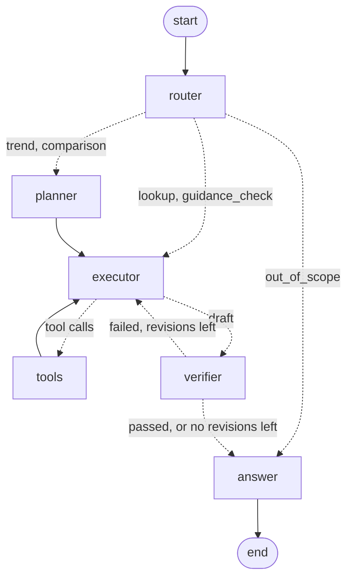

# Agent

How `talk-is-cheap ask` answers questions about the companies in `universe.yaml`: the
graph, the tools and their safety rules, the verifier, what it costs, how it scores on the
smoke set, and what it cannot do.

The agent never does arithmetic in its head, never states a number that is not in a tool
result, and checks its draft before it answers. Every claim cites an SEC filing URL or a
news article link. What executives said in the news comes from `get_statements`, with who
said it, the outcome and the comparison with formal guidance, always "reported by
<publisher>" (section 2, [statements.md](statements.md)). Whether executives kept their
public promises comes from `get_promises` and `get_track_record`, the promise tracker's
verdicts and track records ([promises.md](promises.md)).

## 1. Graph

`agent/graph.py`, drawn by `talk-is-cheap agent-graph` into
[agent-graph.md](agent-graph.md):



State (`AgentState`): `messages`, `question`, `question_type`, `plan`, `evidence` (keyed
by citation id), `draft`, `verifier_feedback`, `revision_count`, `failures` (each with the
check that caught it), `tool_calls`, `usage` (calls, cached calls, tokens and cost per
node), and the `final` answer with its `sources`.

1. **Router** (`agent/router.py`). Rules first, the model only when they cannot decide:
   - advice ("should I buy", "price target", "good investment") and predictions ("will
     the stock", "will Meta beat") are `out_of_scope`, marked as about trading;
   - whether promises were kept ("promise", "deliver on", "kept his word", "track record",
     "hold up", "walked back", "follow through"), with one company or none:
     `guidance_check` ("Which executive's promises hold up best?" names no company);
   - two or more covered companies named: `comparison`;
   - one company and a guidance word (guidance, outlook, expect, beat, miss): `guidance_check`;
   - one company and several periods ("over the last four quarters", "from Q2 2025 to
     Q2 2026"): `trend`;
   - one company and a metric, period, filing section or "why": `lookup`;
   - no company in a follow-up ("and the quarter before?"): the thread's previous type.

   Companies are matched by ticker (upper case only for tickers that are words: META,
   CRM, AMD), name or alias in any case. A news-only company is not covered. Everything
   else ("What was Broadcom's revenue?", "Tell me about Nvidia") goes to the router
   model. An out-of-scope question gets a fixed, polite answer that says what the agent
   can do, "This is not investment advice." when it is about trading, and no tool or
   model call.
2. **Planner**, for `trend` and `comparison` only: at most five steps (one `get_actuals`
   call per company for all periods, a `compute` step for every derived figure), added
   to the question the executor reads.
3. **Executor**: a tool-calling loop through LangGraph's `ToolNode`. Every tool result
   travels as the tool message's artifact and is added to `evidence`. After
   `MAX_TOOL_CALLS` (8) calls in a question, further calls are dropped and the model is
   told to answer from what it has. Its prompt: answer from tool results only, quote
   figures as tools give them, `compute` for every growth rate, margin, difference, sum
   or ratio, cite every sentence with evidence ids (`[E3]`). What executives said comes
   from `get_statements`, reported by the publisher, after the filing or guidance row
   when one gives the same figure; only management claims are the company's; a verdict
   or comparison with guidance is the tool's, never the model's; when a company gives no
   guidance in its releases, that comes first, before anything news reports from calls.
4. **Verifier**: code checks, then the model, only if they pass (section 3). A failure
   adds the feedback as a message and goes back to the executor, at most
   `MAX_REVISIONS` (2) times; then the answer keeps only the sentences that passed and
   says what could not be verified.
5. **Answer**: the answer model edits the verified draft for clarity, seeing only the
   evidence the draft cites. Its edit is kept only if it still passes the code checks and
   cites nothing new; otherwise the draft is used as it is. Then, in code:
   - a cited guidance row flagged by the plausibility check gets a note saying so and
     what the review decided, unless the answer already says it;
   - a sentence about guidance, or any sentence citing an executive's statement from
     `get_statements`, that cites only news says "(reported by <publisher>)";
   - `[E3]` markers become `[1]`, a computed result is cited by the items it was computed
     from, and items from the same document and place share a number;
   - a numbered source list with each filing or article URL goes underneath.

**Memory.** LangGraph's Postgres checkpointer (`langgraph-checkpoint-postgres`) stores
the state per `thread_id`. A follow-up sees the thread's earlier questions and answers
(not their tool calls) and its evidence; citation ids continue across the thread.

The checkpointer's four tables (`checkpoint_migrations`, `checkpoints`,
`checkpoint_blobs`, `checkpoint_writes`) are created by Alembic migration 0009, a
frozen copy of the library's own schema statements (version 3.2.0), with its migration
numbers recorded in `checkpoint_migrations` so the library sees them as applied.
Chosen over a setup call because `make migrate` and the tests' database then get them
like every other table, `alembic downgrade` removes them, and nothing at run time
creates tables. `alembic/env.py` leaves these tables out of autogenerate, since they
are not ORM models, so `alembic check` stays clean. `ask` checks that the recorded
version matches the installed library and asks for a new migration if a library
upgrade adds schema changes.

## 2. Tools

`agent/tools.py`. Each tool is a plain async function with a Pydantic input schema and a
docstring the model reads, and returns evidence items: a citation id (`E1`, `E2`, ...
unique within a conversation), a provenance tag (`sec_filing`, `company_press_release`
or `news_report`), a URL, and the fields the model needs. The model reads them flat, as
compact JSON. A tool that cannot answer returns an `error` the model reads instead of
raising.

| Tool | Input | Returns |
| --- | --- | --- |
| `resolve_company` | name or ticker | CIK, ticker, name, SEC name, fiscal year end, latest reported quarter; or the three closest matches and the covered tickers |
| `get_actuals` | ticker, up to 6 metrics, up to 12 periods (`FY2027Q2`, `FY2026`, `latest`, `latest-1`, ...), vintage `first` or `latest` (default) | one item per metric and period: value, unit, a display form (`$96,221M`), form, filing date, accession number and the filing's primary document URL; derived quarters carry their derivation; what was not found is listed |
| `get_guidance` | ticker, metric, issued period, target period, limit (10, at most 20) | guidance rows, newest issue first: low, high, point, unit, basis, measure, segment, conditions (200 characters), verdict and reason, actual as first reported, difference, the quote (300 characters) and the release URL; `review` when the plausibility check flagged the row and what the reviewer decided. Rows reviewed as wrong have no verdict and `counts_in_verdicts` false, as `guidance` treats them. For a company without guidance: one item stating it, citing its latest release |
| `get_statements` | ticker, metric, period (a target `FY2026Q3`, a fiscal year with its quarters, or a calendar year `2025`), speaker, `management_only` (default true), `checkable_only`, `date_from`, `date_to` (statement dates), limit (10, at most 20) | claims reported in the news, newest first: speaker and role (the roster's when verified), attribution and whether it is management's, venue, date (with a note when it is the article's), publisher, published date, the claim, a quote of at most 40 words, metric, target, figures and unit, direction; for management claims the verdict and its reason, the actual as first reported, the review state, the comparison with formal guidance and the guidance row's range and issue date, and a plan's filing passage. Claims by others say they are not scored. With nothing matching, it says whether claims by others exist. Provenance `news_report` |
| `search_filings` | query, ticker, periods, document types (with Tesla's deliveries reports), section types, `date_from`, `date_to` (filing dates), k (6, at most 10) | `rerank` search (the retrieval default) over filing text: passage (700 characters), period, filing date, document type, section, and the document URL with the chunk's character range |
| `search_news` | query, ticker, `date_from`, `date_to`, k | headline, publisher, date, summary (300 characters), link, and the article's link confidence for the ticker |
| `get_promises` | ticker, query (words the subject or quote contains), speaker, verdict, due before, due after, limit (8, at most 15) | promises made in public, newest first: quote (40 words), speaker, date, publisher and article link, subject, the fixed resolution rule, due date, specificity, bold, the verdict that counts (a review's first; `too_early` or null is "too early to judge"), target, required and measured value, the judge's reasoning, days late, failed checks; and each promise's outcome evidence (at most 3) as items of their own with their filing or article URL. Vague claims have `scored: false`. Provenance `news_report` |
| `get_track_record` | ticker, speaker, by (`executive` or `company`) | per group: claims, resolved claims by verdict, vague claims not scored, and the on-time rate, share walked back, bold share and hit rate and median days late, or `judgment: "too few to judge"` under 5 resolved claims. Each item cites the promises it was computed from (`inputs`), like a `compute` result |
| `cite_value` | an evidence id and the exact span holding one number | the number and its unit, read in code from that item's text, as new evidence with the source's URL and date (used by the promise resolver) |
| `compute` | `pct_change`, `difference`, `ratio`, `sum` or `margin`, over evidence ids (`E3`, or `E5.point` for a field) | the result as new evidence that cites its inputs. `pct_change` and `margin` are in percent. Operands of different units are refused for `pct_change`, `difference` and `sum` |
| `run_sql` | one SELECT | columns and at most 200 rows (cells cut at 300 characters). It has no URL: figures in an answer are cited from `get_actuals` or `get_guidance` |

**`run_sql` safety** (`agent/sql.py`), enforced in code:

- The statement is parsed with sqlglot (Postgres). Exactly one statement, and it must be
  a SELECT or a UNION, INTERSECT or EXCEPT of SELECTs.
- Nothing anywhere in its tree may write: INSERT, UPDATE, DELETE and MERGE (also inside a
  WITH clause), SELECT INTO, FOR UPDATE, DDL, COPY, SET and unparsed commands are refused.
- Tables: only `companies`, `filings`, `financial_values`, `documents`, `sections`,
  `guidance`, `guidance_sources`, `guidance_reviews`, `stock_splits`, `articles`,
  `article_companies`, `statements`, `statement_outcomes`, `promises`, `promise_verdicts`
  and `promise_reviews`, plus the query's own WITH
  names, and no schema but `public`. The
  ledger, agent runs, checkpoints, `pg_catalog` and `information_schema` are out.
- Functions: an allowlist of aggregates, window, arithmetic, string, date and cast
  functions. Anything else is refused, including every function sqlglot does not know:
  `pg_sleep`, `pg_read_file`, `set_config`, `current_setting`, `lo_import`, `dblink`,
  and set-returning functions such as `generate_series` in FROM.
- What runs is the statement as sqlglot read it, regenerated, so what was checked is
  what the database sees.
- It runs in a transaction that is `READ ONLY` with `statement_timeout = 5s`, which is
  rolled back afterwards.

`tests/test_agent_sql.py` tests each rule with 29 attempts to get around it (chained
statements, a DELETE in a CTE, SELECT INTO, quoted function names, catalog tables, a
`';drop table` literal, comments); `tests/integration/test_agent.py` shows the database
itself refusing a write in the read-only transaction and cancelling a `pg_sleep` past the
timeout.

## 3. Verifier

**Code checks** (`agent/checks.py`), run first, at no cost:

| Check | Fails when |
| --- | --- |
| `numbers_grounded` | a number in the draft is in no evidence item and no `compute` result |
| `citations_exist` | a citation id is not an evidence id, or names an item without a URL (`run_sql` rows) |
| `numbers_cited` | a sentence with a number has no citation |

Numbers are normalized before they are compared: `$96.2 billion`, `96.2B`, `$96,221
million` and `$96,221M` are all dollars; `74.98%`, `17 percent` and `50 basis points`
are percent (a percentage also matches a fraction of 1); `$(0.21)` is negative. A number
matches an evidence value within the rounding it was written with: `$96.2 billion`
matches 96,221,000,000 (±0.05 billion), `$96.3 billion` does not. Signs are not compared,
since the words carry them ("a loss of $0.21"). Evidence numbers are its numeric fields
and the numbers written in its text (quotes, passages, headlines). Not numbers: citation
ids, fiscal periods (`FY2027 Q2`, `Q3`, `fiscal 2026`), years, dates, form names (`10-K`),
item numbers, list markers and counts up to 12 without a unit ("the last 4 quarters").
Numbers in the question are allowed.

**Model check**, only when the code checks pass (prompt `verifier/v2`): the verifier
model reads the question, the draft and the evidence it cites, and gives every claim a
verdict: `supported`, `unsupported` (the cited evidence does not say it: a wrong figure,
period, company or metric, a verdict, cause or date it does not give, an uncited fact) or
`prefer_primary` (a figure cited only from news that a cited filing or guidance row also
gives). Unsupported claims are recorded as `llm_unsupported`; `prefer_primary` claims as
`llm_prefer_primary`, and only when the draft cites news at all. A reply without a
usable verdict counts as unsupported.

**Revisions.** Each failure is recorded in `failures` with its check and the revision it
happened in, and counted by check in `agent_runs.verifier_failures`, so catches can be
counted later:

```sql
SELECT key AS check, sum(value::int) FROM agent_runs, jsonb_each_text(verifier_failures)
GROUP BY key;
```

After two revisions the answer keeps the sentences that pass the code checks and are not
named by the model's problems, followed by "Could not be verified: ..." with what failed.

## 4. Cost controls

- **Model.** Haiku 5.5 (`LLM_MODEL`, effort `low`) for every node; `--model` picks
  another of the configured provider. Each node has an output limit (`agent/llm.py:
  MAX_OUTPUT_TOKENS`): router 200 tokens, planner 400, executor 1,200, verifier 1,500
  (a verdict for every claim), answer 900.
- **Ledger and budget.** Every call goes through the guidance code's budget and ledger
  (`guidance/llm.py`, `spend.py`): before a call, its largest cost (its input estimated
  at one token per 2.4 characters of the request plus 600, and its output limit) is
  reserved against the run's cap (`--max-cost`, default `LLM_COST_CAP`) and the total
  budget (`LLM_BUDGET_USD`); a call that could exceed either is refused. Paid calls are
  recorded in `llm_spend` under `ask` or `eval agent`, with the node's prompt version.
- **Estimate first.** `ask` and `eval agent` print an estimate (the average cost of
  measured runs from `agent_runs`, and the worst case) and the remaining budget before
  any call.
- **Response cache.** Every call is cached by model, the node's prompt version and a
  hash of its messages, tools and tool choice (message ids left out, since the graph
  makes new ones on every run). An identical question on a new thread is free: tool
  results are deterministic and citation ids start at `E1` on every thread. The
  executor's prompt contains today's date, so the cache turns over daily.
- **Small requests.** Tool results carry only the fields the model needs, with passages,
  quotes and summaries cut; earlier turns are passed as their questions and answers,
  without their tool calls; the verifier and answer models see only the evidence the
  draft cites; questions the rules can route make no router call; out-of-scope questions
  make none at all.

## 5. Smoke set

`evals/agent/smoke.jsonl`: 20 questions over the stored data: 5 lookups (one asks for a
value as first reported and as latest reported: Tesla's Q1 2024 net income, restated
from $1,129M to $1,390M), 4 guidance checks (Qualcomm's GAAP EPS guidance for fiscal Q3
2026, flagged by the plausibility check and reviewed as ok; Apple, which gives none;
Nvidia and AMD revenue), 4 trends, 3 comparisons of two companies, 2 that need filing
text (Nvidia's MD&A, Tesla's risk factors) and 2 out of scope (advice on Nvidia stock,
Broadcom, which is not covered).

Each question lists facts code checks against the database, never wording: a reported
value (ticker, metric, period, vintage) read from `financial_values` when scoring, a
margin or percent change computed from two of them, a guidance row's figures, verdict and
flag, "no guidance", phrases a filing passage must contain plus a cited filing with that
section, or a refusal. `talk-is-cheap eval agent` (`make smoke-agent`) scores each
question on:

- **facts**: the share of its facts stated correctly (a number within the rounding it is
  written with, or 0.5%);
- **citations**: every marker has a source, every source URL is a stored document,
  filing, article or EDGAR company page, and an in-scope answer has at least one;
- **grounded**: the final answer passes the verifier's code checks;
- **refusal**: out-of-scope questions, and only they, are declined without tool calls.

`--dry-run` runs everything with a scripted model (`agent/smoke.py: dry_run_script`) that
calls the tools the facts need, computes derived figures and writes the draft from the
results. It checks the harness, tools, verifier and scoring at no cost; it scores 20 of
20.

### Results

Run on 2026-10-19 with Claude Haiku 5.5 (effort `low`) for every node, on the stored data
of the 15 companies. Each question on its own thread. Facts / citations / grounded /
refusal, tool calls, revisions, cost and seconds:

| Question | Type | Facts | Cites | Grounded | Refusal | Tools | Rev. | Cost | s |
| --- | --- | --- | --- | --- | --- | --- | --- | --- | --- |
| lookup-nvda-revenue | lookup | 1.00 | yes | yes | yes | 1 | 0 | $0.0000 | 0 |
| lookup-aapl-net-income | lookup | 1.00 | yes | yes | yes | 1 | 0 | $0.0010 | 4 |
| lookup-tsla-first-vs-latest | lookup | 1.00 | yes | yes | yes | 2 | 1 | $0.0019 | 9 |
| lookup-googl-eps | lookup | 1.00 | yes | yes | yes | 1 | 0 | $0.0010 | 4 |
| lookup-meta-capex | lookup | 1.00 | yes | yes | yes | 1 | 0 | $0.0010 | 4 |
| guidance-qcom-eps-flagged | guidance check | 1.00 | yes | yes | yes | 2 | 2 | $0.0035 | 14 |
| guidance-aapl-none | guidance check | 1.00 | yes | yes | yes | 2 | 1 | $0.0024 | 10 |
| guidance-nvda-revenue | guidance check | 1.00 | yes | yes | yes | 3 | 1 | $0.0025 | 9 |
| guidance-amd-revenue | guidance check | 1.00 | yes | yes | yes | 2 | 0 | $0.0010 | 6 |
| trend-nvda-revenue | trend | 1.00 | yes | yes | yes | 4 | 0 | $0.0023 | 8 |
| trend-amzn-operating-income | trend | 1.00 | yes | yes | yes | 1 | 0 | $0.0016 | 8 |
| trend-nflx-revenue-growth | trend | 1.00 | yes | yes | yes | 3 | 1 | $0.0027 | 12 |
| trend-meta-capex | trend | 1.00 | yes | yes | yes | 5 | 1 | $0.0039 | 14 |
| compare-msft-googl-revenue | comparison | 1.00 | yes | yes | yes | 6 | 1 | $0.0030 | 10 |
| compare-aapl-meta-gross-margin | comparison | 1.00 | yes | yes | yes | 5 | 0 | $0.0028 | 9 |
| compare-meta-googl-net-income | comparison | 1.00 | yes | yes | yes | 6 | 1 | $0.0040 | 16 |
| text-nvda-mdna | lookup | 1.00 | yes | yes | yes | 1 | 2 | $0.0038 | 14 |
| text-tsla-risk-musk | lookup | 1.00 | yes | yes | yes | 1 | 2 | $0.0047 | 18 |
| scope-buy-nvda | out of scope | 1.00 | yes | yes | yes | 0 | 0 | $0.0000 | 0 |
| scope-broadcom | out of scope | 1.00 | yes | yes | yes | 0 | 0 | $0.0001 | 1 |

**20 of 20 pass all four scores**, after one prompt change and a re-run of the four
questions that failed. `lookup-nvda-revenue` came from the cache: the same question had
been asked with `ask` just before, for $0.0010. `scope-buy-nvda` is declined by the rules
with no model call; `scope-broadcom` by the router model. Results:
`evals/agent/results/20261019T195848Z.json` (all 20) and `20261019T200414Z.json` (the
four re-run).

**First run** (verifier prompt `v1`): facts 1.00, citations 20 of 20, refusals 20 of 20,
but grounded only 16 of 20, at $0.0485 for 110 paid calls in 197 seconds. The four failures
(Qualcomm and AMD guidance, Meta's capex trend, Microsoft against Alphabet) all had the
same two causes:

- The verifier model reported claims it agreed with as problems: v1's schema only had
  a list of problems, and Haiku listed every claim, many ending "This is supported". Each
  question used all its revisions, and 37 `llm_unsupported` catches in 9 runs were mostly
  of this kind. It also raised `prefer_primary` on answers that cited no news at all.
- After the last revision, the note listing what could not be verified quoted the
  failed claims with their figures, so the answer then failed the code checks itself.

Fixes: verifier prompt `v2` gives each claim a verdict (`supported`, `unsupported`,
`prefer_primary`) and only the last two fail the draft; `prefer_primary` counts only
when the draft cites news; the note says how many statements were left out and why,
without their figures. The four questions re-run with `v2`: all four pass, $0.0113.

**Cost.** $0.0485 for the first run and $0.0113 for the re-run; about $0.0024 a question
on average, $0.001 for a single-value lookup and $0.003 to $0.005 for comparisons,
trends and filing-text questions, which make more tool calls and revisions. Over all
runs, the executor took 79% of the input tokens and 72% of the cost (the system prompt,
seven tool definitions and the tool results, sent again on every turn of the loop), the
verifier 15% and 20%, the answer, planner and router the rest.

**Verifier catches**, over all 28 runs of the day (`agent_runs.verifier_failures`):

| Check | v1 (22 runs) | v2 (6 runs) |
| --- | --- | --- |
| `numbers_grounded` (code) | 3 in 1 run | 0 |
| `numbers_cited` (code) | 5 in 4 runs | 2 in 1 run |
| `citations_exist` (code) | 0 | 0 |
| `llm_unsupported` (model) | 37 in 9 runs | 4 in 4 runs |
| `llm_prefer_primary` (model) | 7 in 2 runs | 0 |

Code checks caught 10 problems, the model 48 (v1) and 4 (v2). The `numbers_grounded`
catches were all in the first Microsoft-against-Alphabet run, the `numbers_cited` ones
sentences that restated figures without a citation (in v2: Qualcomm's answer repeating
the plausibility check's $1.36 and $6.88 and the $1.87 actual). Under v2, three of the
model's four catches are in the smoke results, all real but small: a non-GAAP EPS range cited to the GAAP guidance row, a claim
that Meta's Q1 2026 capex was derived when it was reported, and a remark on fiscal
calendars that no evidence states.

**Follow-up on one thread** (`ask --thread`):

```
$ talk-is-cheap ask "What was NVDA's revenue last quarter?" --thread followup-1792440321
Nvidia's revenue for its latest reported quarter, FY2027Q2 (ended July 26, 2026), was
$96.2 billion [1].
1 tool calls, 8,641 input and 390 output tokens, $0.0011, 4.6s, 0 revisions, 0 of 4 model calls cached

$ talk-is-cheap ask "And the quarter before?" --thread followup-1792440321
The quarter before last quarter was FY2027Q1 (ended April 26, 2026), with revenue of
$81,615M, or $81.6 billion [1].
1 tool calls, 15,267 input and 1,160 output tokens, $0.0021, 9.5s, 1 revisions (verifier: llm_unsupported 1), 0 of 6 model calls cached
```

The second question names no company: the router keeps the thread's type by rule, the
executor reads the earlier question and answer and asks `get_actuals` for `latest` and
`latest-1`, and citation ids continue at E2.

### With `get_statements` (prompts v2), 2026-10-20

Router, planner, executor and answer prompts are `v2` (verifier `v2` unchanged): the
router counts what management said about the future as a guidance question, the planner
lists `get_statements`, the executor and answer prompts carry the rules of section 1.
Run on the same 20 questions to check for regressions:

| Question | Type | Facts | Cites | Grounded | Tools | Rev. | Cost |
| --- | --- | --- | --- | --- | --- | --- | --- |
| lookup-nvda-revenue | lookup | 1.00 | yes | yes | 1 | 0 | $0.0010 |
| lookup-aapl-net-income | lookup | 1.00 | yes | yes | 1 | 0 | $0.0010 |
| lookup-tsla-first-vs-latest | lookup | 1.00 | yes | yes | 2 | 1 | $0.0024 |
| lookup-googl-eps | lookup | 1.00 | yes | yes | 1 | 0 | $0.0010 |
| lookup-meta-capex | lookup | 1.00 | yes | yes | 1 | 0 | $0.0013 |
| guidance-qcom-eps-flagged | guidance check | 1.00 | yes | yes | 2 | 0 | $0.0018 |
| guidance-aapl-none | guidance check | 1.00 | yes | yes | 3 | 2 | $0.0061 |
| guidance-nvda-revenue | guidance check | 1.00 | yes | yes | 2 | 0 | $0.0017 |
| guidance-amd-revenue | guidance check | 1.00 | yes | yes | 2 | 0 | $0.0016 |
| trend-nvda-revenue | trend | 1.00 | yes | yes | 6 | 1 | $0.0038 |
| trend-amzn-operating-income | trend | 1.00 | yes | yes | 2 | 0 | $0.0017 |
| trend-nflx-revenue-growth | trend | 1.00 | yes | yes | 2 | 1 | $0.0029 |
| trend-meta-capex | trend | 1.00 | yes | yes | 6 | 0 | $0.0032 |
| compare-msft-googl-revenue | comparison | 1.00 | yes | yes | 4 | 0 | $0.0026 |
| compare-aapl-meta-gross-margin | comparison | 1.00 | yes | yes | 5 | 0 | $0.0033 |
| compare-meta-googl-net-income | comparison | 1.00 | yes | yes | 6 | 0 | $0.0026 |
| text-nvda-mdna | lookup | 1.00 | yes | yes | 1 | 1 | $0.0029 |
| text-tsla-risk-musk | lookup | 1.00 | yes | yes | 2 | 1 | $0.0052 |
| scope-buy-nvda | out of scope | 1.00 | yes | yes | 0 | 0 | $0.0000 |
| scope-broadcom | out of scope | 1.00 | yes | yes | 0 | 0 | $0.0000 |

**20 of 20 pass all four scores**, $0.0461 for 85 paid calls
(`evals/agent/results/20261020T123800Z.json`). The first run with the new tool
(`20261020T123442Z.json`, $0.0506) passed 19: asked for Apple's guidance, the agent led
with the 9% to 11% growth Apple gives on its call, as reported by Yahoo Finance and
TechCrunch, and never said that Apple's releases give none. The executor prompt then got
its rule that the releases' lack of guidance comes first; the rerun passed.

### News questions

`evals/agent/news.jsonl`: 8 questions about what executives said in the news, with
facts checked against `statements`:

- `statement`: a management claim (ticker, metric, target period); the answer states its
  figure, its verdict when the question asks how the result compared, the comparison
  with formal guidance when the question asks it, and "reported by", citing an article;
- `no_management_claims`: the answer says management made no such claim; an analyst's
  figure, if stated, is attributed to the analyst.

The questions: Qualcomm's statements against its formal guidance (both checkable ones
consistent; the claim that differed was an extraction error reviewed as wrong), Meta's
2025 capex (no management claim in stored news; the guidance rows and the 10-K answer
it), Nvidia's revenue outlook for fiscal Q2 2025 and Q2 2027 (both beaten), Tesla's and
Amazon's 2026 capex (pending), Salesforce's fiscal 2030 target (no formal guidance within
45 days), and the growth of iPhone Duo shipments next year, where the only claim is
IDC's.

| Question | Facts | Cites | Grounded | Tools | Rev. | Cost |
| --- | --- | --- | --- | --- | --- | --- |
| news-qcom-vs-guidance | 1.00 | yes | yes | 2 | 2 | $0.0119 |
| news-meta-capex-2025 | 0.50 | yes | yes | 3 | 2 | $0.0044 |
| news-nvda-q2fy25-revenue | 1.00 | yes | yes | 2 | 2 | $0.0060 |
| news-nvda-q2fy27-revenue | 1.00 | yes | yes | 3 | 0 | $0.0021 |
| news-tsla-capex-2026 | 1.00 | yes | yes | 2 | 0 | $0.0016 |
| news-crm-fy2030-target | 1.00 | yes | yes | 2 | 1 | $0.0031 |
| news-amzn-jassy-capex | 1.00 | yes | yes | 2 | 0 | $0.0018 |
| news-aapl-duo-analyst-only | 1.00 | yes | yes | 4 | 2 | $0.0095 |

**7 of 8 pass all four**, $0.0404 for the run with the final prompts
(`20261020T124043Z.json`, scored again from the cache in `20261020T124306Z.json`). The
Meta answer says no executive claim was found, lists the guided ranges and both actuals
($72.2 billion with finance leases, $69.7 billion in the 10-K), but never says the
guidance was beaten. No answer presented the IDC figure or any analyst's claim as
Apple's or Qualcomm's.

How the set and its checks changed, in order: the first run (`20261020T123144Z.json`,
$0.0401) passed 4 of 8. Three failures were the checks' wording, not the answers: "made
no stored management statements" and "could not find any Apple executive statement" did
not match the no-claim pattern, "beaten" did not match the beat pattern, and "no formal
FY2030 revenue guidance" did not match the no-guidance pattern; the patterns were
widened. The facts of two questions asked for things the questions do not (a comparison
with guidance for Nvidia's Q2 fiscal 2025 outlook; verdicts for Qualcomm's, Tesla's and
Amazon's), and were narrowed with `outcome: false`. All of this is in the results files.
The set is small, was drafted from the stored data without the project's own list of
news questions, and was used to fix one prompt rule; there is no held-out set.

### With the promise tracker (prompts v3), 2026-10-20

Router, planner, executor and answer prompts are `v3` (verifier `v2` unchanged): the
router sends promise questions to the guidance-check path by rule, the planner lists
`get_promises` and `get_track_record`, the executor's rules say a promise's verdict is the
tool's, "too early to judge" and "not scored" are said as such, and the claim's article
and the outcome evidence are cited; the answer keeps those phrases.

**Smoke set: 20 of 20 pass all four scores**, $0.0666 for 108 paid calls
(`evals/agent/results/20261020T173641Z.json`): no regression.

**News set**: 14 questions, the 8 earlier ones and 6 about promises (Nvidia's Blackwell
and dividend promises, AMD's 2024 AI revenue, Musk's Roadster production, which must be
"too early to judge", Jensen Huang's "poised for our next wave of growth", which must
not be scored, and "Which executive's promises hold up best?", whose groups are "too few
to judge" but Nvidia's company statements). Their facts are checked against `promises`
(`agent/smoke.py`: `promise`, `not_scored`, `track_record`).

The run stopped at its $0.07 cap after the 8 earlier questions
(`20261020T174020Z.json`): 6 of 8 pass, against 7 of 8 before. Meta's capex question
fails as before. `news-nvda-q2fy25-revenue` regressed: its draft wrote "May 22–23, 2024",
the number check read "–23" as a figure, and after two revisions the news sentences were
left out, so the answer cites only the release. The number check now strips day ranges
("May 22–23", tested), at no cost. **The 6 promise questions were not run with the
model**: the promise tracker's spending had reached its share of the budget. With the
scripted model (`eval agent --dry-run`) all 6 pass, which checks the tools, the routing,
the harness and the scoring, not the model's answers.

## 6. Known limitations

- **The smoke set is small and was used to fix the prompt.** 20 questions, and the
  verifier prompt was changed after seeing four of them fail; only those four were run
  again. There is no held-out set, and Haiku's answers vary from run to run, so a
  re-run can need different revisions.
- **Revisions are common and slow.** 10 of the 20 final runs needed at least one
  revision, adding 5 to 10 seconds each. Most were the model verifier's (v1). A revision
  sends the whole loop again, so it about doubles a question's cost.
- **The model verifier is the weak check.** Under v1 it flagged supported claims; under
  v2 it is better but still judges wording ("both quarters end June 30" is supported only
  if the evidence carries `period_end`). The code checks are the guarantee: no figure
  reaches an answer unless it is in the evidence, within its rounding.
- **Grounding is about numbers, not meaning.** A figure that is in the evidence but
  attached to the wrong period or metric passes the code checks; only the model check can
  catch it. Small counts (up to 12) without a unit are not checked.
- **Questions are answered from what is stored**: XBRL values of eleven metrics, guidance
  extracted from releases, filing text, news headlines with feed summaries, and
  executives' statements extracted from the article text of the stories that could be
  fetched (a third of them: [statements.md](statements.md)). Segment revenue, non-GAAP
  actuals and anything said on a call that no stored article reports are not available,
  and the agent says so rather than estimating.
- **`run_sql` results cannot be cited**, since rows have no URL; figures must come from
  `get_actuals` or `get_guidance`. Its table allowlist excludes `chunks` and
  `xbrl_facts`.
- **Periods.** "Last quarter" is the company's latest quarter with values, through
  `latest`; calendar quarters of companies with other fiscal years ("Microsoft's June
  quarter") rely on the model reading `period_end`. Fiscal labels follow the project's
  rule (named by the calendar year the fiscal year ends in).
- **The cache turns over daily**, since the executor prompt carries today's date; a
  re-run on the same day is free.
- **Out-of-scope rules are keyword rules.** A question about trading worded without the
  listed phrases goes to the router model, which decides.
