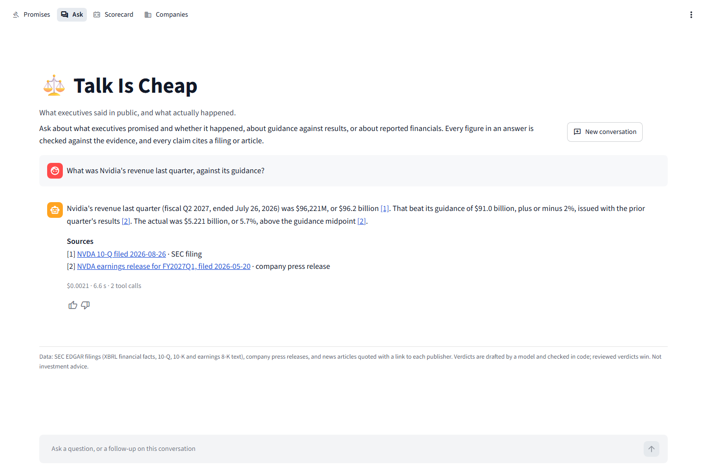
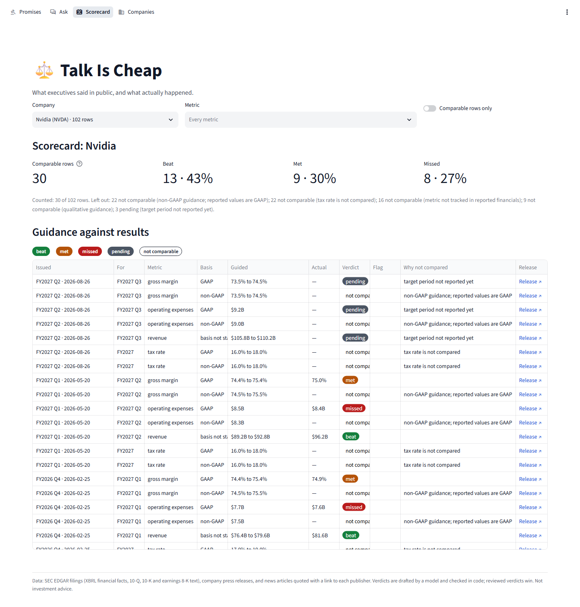

# Web UI

`talk-is-cheap ui` serves a browser UI (Streamlit) that shows what the project is for:
what executives said in public, and what actually happened. It is a thin client of the
HTTP API ([api.md](api.md)): every page reads through the API's endpoints, and it never
opens the database or runs the agent itself.


Code: `src/talk_is_cheap/ui/` (`app.py` the page frame and navigation, `client.py` the
API client, `data.py` cached reads, `format.py` names, units and sentences, `theme.py`
badges, legend, header and footer, `views/` one module per page, `server.py` the
command). Theme and server options are in `.streamlit/config.toml`.

## 1. Pages

### Promises (the front page)

**Pickers.** A company (or all of them); an executive, listed from that company's
claims, with company statements and spokespeople as one "company statements" group per
company, as track records group them; verdicts (several at once); a due-date range;
"bold claims only"; and "show scheduled actions" (stock splits and dividends on a fixed
date), off by default because track records leave them out. The company and an opened
claim are in the URL (`/?company=NVDA&claim=1812`), so either can be linked to.

**Track record of the selection.** From `GET /v1/track-record`: per executive
(`by=executive`), per company (`by=company`), or for all companies at once (`by=all`).
Resolved claims; on time, late, walked back and expired unproven; median days late;
the bold-claim hit rate. The rates follow [promises.md](promises.md) section 5: only
specific and partial claims count, each promise once, expired claims are shown but never
resolved, scheduled actions and claims restating formal guidance are left out. A group
with fewer than 5 resolved claims shows **"too few to judge"** with its counts ("Too few
to judge: 2 resolved claims of 8 scorable claims; rates need 5."), never a rate. The
pickers below the company and executive (verdict, due date, bold) narrow the table, not
the track record.

**Thin and empty data, said plainly.** Above the strip, one sentence about the
selection's claims: "No management claims are stored for Tesla yet.", "1 claim, none of
them scorable: vague claims are never scored.", "4 claims, none due yet. The earliest is
due in March 2027.", or "91 claims, 13 past their due date, 13 with a verdict."

**The table**, one claim per row: statement date and speaker (with the company), the
quote (at most 40 words, as the API cuts it), the due date or "no deadline", the verdict
as a coloured badge, the measured value against the target ("$30.04 billion vs $28
billion", "target 2x", "event" for claims without a figure), "revised before due", the
publisher and a link to the article.

**Drill-down.** A clicked row opens below the table (`GET /v1/promises/{id}`): the full
quote with a link to the original article; the resolution rule and its version, written
when the claim was framed and never rewritten; the due date and how it was set, the
target and baseline; the verdict with its meaning, when it was judged, the measured
value, the first proof and days late, and the judge's reasoning; each cited piece of
evidence with its date, source type (SEC filing, company press release, news report),
link, its key sentence and what the judge found it to show; every code check, passed,
failed or a note; and any review, which always wins.

**Verdict colours**, the same on every page, with a legend above each table:

| Colour | Promises | Guidance |
| --- | --- | --- |
| green | delivered | beat |
| amber | delivered late, partly delivered | met |
| red | not delivered, walked back | missed |
| grey | too early, pending (not judged yet), not scored (vague, or scored with guidance) | pending |
| outlined | cannot determine, expired unproven | not comparable |

Badges are white text on a saturated fill, or outlined in the text colour, so they read
the same in the light and the dark theme.

### Ask



A chat over `POST /v1/chat`. While the agent works, a status box shows each `status`
event ("Reading reported financials…", "Searching filings…") and each tool call from
`tool_start` and `tool_end` with its result summary. The answer arrives as `token`
events (only once the verifier has passed it, [api.md](api.md) section 4); its [n]
markers then link to the filing or article of each `citation` event, listed as sources
with their provenance (SEC filing, company press release, news report). Under each
answer: cost, seconds and tool calls from the `done` event ("$0.0016 · 4.6 s · 1 tool
call", "no cost" for the free model, "from the cache, no cost"), and a thumbs up or
down with an optional comment, sent to `POST /v1/feedback` with the answer's request id.

Follow-ups go on the same thread (`thread_id` from the stream); "New conversation"
starts a new one. Four example questions start a conversation with one click, two of
them about promises. Errors are one sentence, never a traceback: a spent budget ("The
question budget is used up for today; it resets at midnight UTC."), a rate limit ("Try
again in 17 seconds."), a question over the API's time limit, a full or busy thread, no
model configured, or the API out of reach.

### Scorecard



A company's formal guidance from its earnings releases (`GET
/v1/companies/{ticker}/guidance`): quarter issued and its date, target period, metric
(and segment), basis, the guided range or point against the actual as first reported,
the verdict badge, a flag for rows the plausibility check flagged ("⚑ needs review") or
that were reviewed ("✕ reviewed: wrong", "✓ reviewed: ok"), why a row is not compared,
and a link to the press release. Figures carry their units and periods ("$105.8B to
$110.2B", "74.0%", "+9.0% y/y", "FY2027 Q3").

The summary counts beat, met and missed over comparable rows only, and says how many
were left out and why: "Counted: 30 of 102 rows. Left out: 22 not comparable (non-GAAP
guidance; reported values are GAAP); 22 not comparable (tax rate is not compared); …; 3
pending (target period not reported yet)." Flagged rows not reviewed and rows reviewed
as wrong are left out too, as the `guidance` command leaves them out. A company without
guidance in its releases (Apple, Alphabet, Microsoft) says so. Pickers: the company (in
the URL, `?company=NVDA`), metrics, "comparable rows only".

### Companies

The coverage of `GET /v1/companies`: latest quarter, filings, guidance rows, linked
articles, management claims and due claims per company, most claims first, with one
sentence on where the data is thin ("15 companies, 357 management claims from the news,
43 of them due to be judged. Most claims are not due yet: …").

Every page ends with the data sources and "Not investment advice".

## 2. Configuration

| Variable | Default | Purpose |
| --- | --- | --- |
| `UI_API_URL` | `http://127.0.0.1:8080` | The API the UI calls, from the Streamlit server |
| `UI_API_KEY` | unset | One of the API's `API_KEYS`; unset when the API runs without keys (`local`, `test`) |
| `UI_PORT` | `8501` | Port of `make ui`, and the host port of the `ui` service in Docker |

Both `UI_` settings are read from the environment or `.env` (`ui/config.py`).

**The API key stays on the server.** Streamlit runs the pages in Python on its own
server and sends the browser only rendered elements over its websocket. The client
(`ui/client.py`) is built there from `UI_API_KEY` and sends it in `X-API-Key` on every
request; the browser never calls the API, never receives the key, and the key is not in
any page, URL or error message (a test renders the whole app with a key set and checks
it appears nowhere). The client's `repr` and the settings' `repr` leave it out. So the
API needs no `CORS_ORIGINS` for the UI, and in Docker the API's port need not be
published for the UI to work.

**One client.** `ui/client.py` holds the base URL, the key and the timeouts (20 seconds
for data, 5 to connect, 90 for a chat stream, whose questions end within the API's
60-second limit). Responses are read into the API's own Pydantic models
(`api/schemas.py`), so the UI and the API cannot drift apart. Every failure is an
`ApiError` with a message fit to show: `Unauthorized` (401), `BudgetExceeded` (402),
`NotFound` (404), `RateLimited` (429, with `Retry-After`), `ServerError` (5xx), and
`Unreachable` (refused connection or timeout). A chat stream's `error` event raises the
same classes, by its status and code.

**Caching.** Data reads are cached for 60 seconds with `st.cache_data`, keyed by the
API's URL and the arguments, so changing a filter, opening a claim or switching pages
does not call the API again; an error is never cached. Chat and feedback are never
cached. Filters are applied in the page to a company's whole list of claims (one request
per company, every page of it), since the API filters by one verdict at a time.

## 3. Running it

Locally, with the API running (`make api`, or `LLM_PROVIDER=fake make api` for a chat
that costs nothing):

```bash
make ui                                  # 127.0.0.1:8501, against 127.0.0.1:8080
UI_API_URL=http://127.0.0.1:8081 make ui # another API
uv run talk-is-cheap ui --host 0.0.0.0 --port 8501
```

`talk-is-cheap ui` replaces itself with `streamlit run src/talk_is_cheap/ui/app.py`
(signals reach Streamlit directly). Streamlit reads `.streamlit/config.toml` from the
working directory, so run it from the project root. Importing the CLI does not import
Streamlit; only this command loads it.

In Docker:

```bash
docker compose up --build    # db, migrate, api, then ui once the api is healthy
open http://localhost:8501
```

The `ui` service runs the same image as the API with the command `talk-is-cheap ui`,
`UI_API_URL=http://api:8080` and the rest of `.env` (`UI_API_KEY` among it); it waits
for the API's health check and has its own (`/_stcore/health`). One image keeps the
setup simple: the client reuses the API's response models from the package, so a
separate UI image would need the package anyway, and one lockfile, one build and one
image to update are less to keep in step than two. Streamlit and its dependencies add about 80 MB
to the 1.3 GB image, which already holds the search models' runtime.

**Themes.** `.streamlit/config.toml` defines a light and a dark theme; the viewer's
system setting picks one, and Streamlit's settings menu switches. Tracebacks are never
shown to viewers (`showErrorDetails = "none"`); errors the pages expect are shown as
messages.

## 4. Tests

No API key and no network: `tests/test_ui_client.py` runs every client method against
`httpx.MockTransport`: pagination, query parameters, the key header, each error status
and a refused or slow connection, and the chat stream with every event type, an `error`
event of each code, errors before the stream, a stream cut short and an unreadable
event. `tests/test_ui_pages.py` renders each page with Streamlit's `AppTest` and a fake
client (`tests/ui_fakes.py`), with data, with no data and with the API failing: the
track record's "too few to judge" under 5 resolved claims, the thin-data sentences, the
filters, the drill-down's evidence links and checks, a streamed answer with linked
citations, follow-ups on one thread, feedback and errors in Ask, the scorecard's counts
and exclusions, and the whole app's header and footer with the key never shown.
`tests/test_ui_format.py` covers names, units, periods and sentences, and checks that
importing the CLI does not import Streamlit and that the UI imports neither the
database layer nor the agent's graph.

## 5. Known limitations

- **Filtering reads whole lists.** "All companies" reads every company's claims (15
  requests, then cached for a minute); fine for hundreds of claims, slow for many
  thousands.
- **The drill-down opens below the table**, not beside the clicked row; long tables
  scroll.
- **Answers arrive whole.** The API streams the answer only after verification, so a
  question shows progress, then its whole answer quickly; no early words.
- **A conversation lives in the browser session.** Reloading the page starts a new one;
  the API keeps the thread (`GET /v1/threads/{id}`), but the UI does not reopen it.
